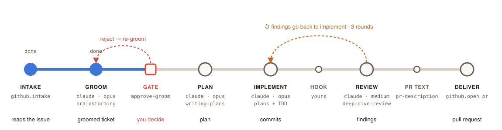
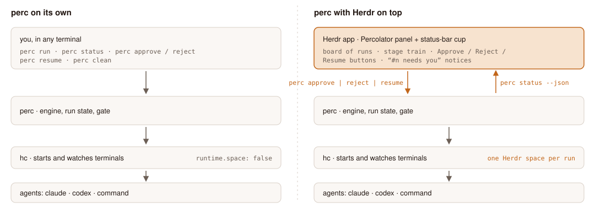
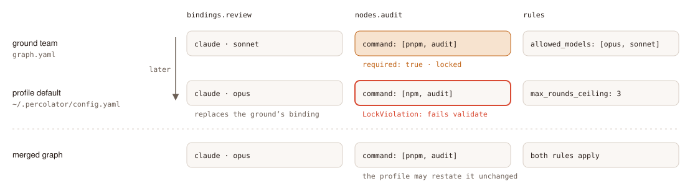

<p align="center">
  <picture>
    <source media="(prefers-color-scheme: dark)" srcset="assets/mark-on-dark.svg">
    
  </picture>
</p>

<h1 align="center">Percolator</h1>

<p align="center"><b>Tickets in. Pull requests out.</b></p>

Percolator is a deterministic software factory. Point `perc` at a GitHub issue and it takes the ticket through six fixed stages: intake, groom, plan, implement, review and deliver. You choose the agent or builtin for each stage. The run stops for your approval after groom and saves every step, so it can stop and pick up where it left off.

## What you need

**Required**

- **Node 24** or later, and **git**. Windows, Linux and macOS all work.
- **[`gh`](https://cli.github.com)**, logged in (`gh auth login`). Intake reads the issue, the gate posts to it and deliver opens the PR through it.
- **`hc`**, Herdr's terminal CLI. Every step runs in a terminal it starts.
- **The agent CLIs your config names:** `claude` for the example config, `codex`, or any command.

**Optional**

- **The [Herdr](https://herdr.dev) app**, for a Herdr space per run and the Percolator panel. Runs create a space by default, so without the app, set `runtime: { space: false }` in your profile. See [Integrations](#integrations).

Percolator isn't on npm yet: install it from a checkout as in [Local development](#local-development), and use `node <checkout>/src/cli.ts` wherever this README says `perc`.

## Quick start

| | Command | What it does |
|---|---|---|
| 1 | `perc init` | Writes an example config to `~/.percolator/config.yaml`. Edit it freely. |
| 2 | `perc validate` | Loads the config, resolves and pins grounds, and prints the graph a run would walk. |
| 3 | `perc run owner/repo#42` | Starts a run. It stops once, after groom, for you to approve the ticket. |

`perc run` starts the run's driver in a terminal of its own; add `--foreground` to drive it in yours. `perc status` lists runs and `perc status <id>` shows one. `perc delete <id>` removes a run you no longer need, and `perc delete --finished` every completed or failed one; both keep the branch. Run `perc --help` for every command and its options.

> [!IMPORTANT]
> **Before your first run with `claude` agents,** trust the repo and `~/.percolator` once in Claude Code. Each agent starts with `--add-dir ~/.percolator/runs/<run-id>` to read its task and write its outputs. If that folder is not trusted, Claude Code asks whether to trust it, and answering no ends the agent and pauses the run.

## A run, stop by stop

Every run follows the same six stages in the same order. You choose what runs at each stage, but you cannot skip or reorder them. One gate is built in: after groom, the run waits for you.

<picture>
  <source media="(prefers-color-scheme: dark)" srcset="assets/diagram-run-dark.svg">
  
</picture>

The diagram shows the example config mid-run: intake and groom are done, and the run waits at the `approve-groom` gate. Rejecting with feedback re-runs groom. Review can send work back to implement for up to 3 rounds; after the third, it delivers anyway and lists the unresolved findings in the PR. Hooks, like the one after implement, are optional nodes you add `before` or `after` any stage, or `all`.

| Stop | What can run there | Done when |
|---|---|---|
| **intake** | builtin `github.intake` | The issue is read and the run has a ticket. |
| **groom … review** | an `agent`, `script` or `builtin` node, or a list of them | The step wrote `done.json` and its `outputs/<key>.md`. |
| **approve-groom** | `gate`, built in and locked, always after groom | You approve, locally or with a `/percolator approve` comment on the issue. A rejection re-runs groom, 3 times at most. |
| **deliver** | builtin `github.open_pr` | The branch is pushed and the PR is open. |

## The engine

Nothing in Percolator is improvised at run time. The config is merged into a graph before the first step starts, the graph is fixed for the whole run, and each step's result is written to disk before the next step begins.

<picture>
  <source media="(prefers-color-scheme: dark)" srcset="assets/diagram-engine-dark.svg">
  
</picture>

The layers merge into one graph: the core stages, your hooks and bounded back-edges (loops back to an earlier stage, with a round cap). `runGraph` hands each step to the runtime and saves state after it. A step counts as done only when it has written `done.json` and its outputs. The terminal's status is used only to notice an agent that needs you.

Each run works in its own git worktree at `<repo>/.worktrees/<run-id>`, on a branch named `percolator/<run-id>`. The worktree is inside the repo, so the repo's agent trust covers it, and Percolator lists `.worktrees/` in `.git/info/exclude` so it never shows up in `git status`.

**Deterministic**

- The graph is built and validated before the first step.
- Grounds are pinned to a commit in `percolator.lock`.
- Run ids, terminal names and posted comments are stable, so a resume finds them instead of duplicating them.

**Bounded**

- Every loop has a round cap. Review delivers at its cap; any other back-edge pauses the run and escalates to you.
- `perc resume` on a run paused at a cap grants exactly one more round.

## Integrations

`perc` is complete on its own: it starts runs, waits at gates and takes your answers on the command line. An integration adds a view on top. It reads `perc status --json`, a stable and versioned contract, and answers by running `perc` commands, as you would by hand. It never talks to the engine directly.

| Integration | Adds | Lives in |
|---|---|---|
| [Herdr](#herdr) | A space per run, a live board of runs, Approve / Reject / Resume / Delete buttons, notices | [`herdr/`](herdr/) |

### Herdr

The Herdr app adds a space per run, and the Percolator panel adds a live board of every run and buttons for the same commands. Agents run in terminals started by `hc` either way.

<picture>
  <source media="(prefers-color-scheme: dark)" srcset="assets/diagram-modes-dark.svg">
  
</picture>

To set it up:

1. Copy `herdr/layouts/percolator.json` and the two folders in `herdr/mods/` into `~/.config/herdr-app`.
2. Run `perc herdr link` once, so the panel knows which `node` and CLI to run.

For the full steps, keys and checks, see [`herdr/RECIPE.md`](herdr/RECIPE.md).

## Configuration

The config is `~/.percolator/config.yaml`, or the file you pass with `--config`. It holds **profiles**: each binds the stages, adds hook nodes, sets rules and pulls shared files from **grounds**. Every key is in `schema/percolator.schema.json`; point your editor at it for completion.

### Example config

This is what `perc init` writes:

```yaml
version: 1
profiles:
  default:
    match: { remote: "github.com/*/*" }     # which repos: globs host/owner/repo (or match.path)
    bindings:
      intake: { builtin: github.intake }      # builtins are handled by Percolator itself
      groom:
        agent: claude                         # claude, codex or command
        model: opus
        skill: superpowers:brainstorming      # loaded as a plugin for claude; SKILL.md in the task otherwise
        prompt: |
          Let's brainstorm this ticket to make sure it matches expectations before we move on to planning or implementing it.
          Write the agreed ticket (goal, acceptance criteria, out of scope, open questions) as the groomed ticket, then stop: no plan and no code.
      plan:
        agent: claude
        model: opus
        skill: superpowers:writing-plans
      implement:
        agent: claude
        model: opus
        skills: [superpowers:executing-plans, superpowers:test-driven-development]
      review:
        agent: claude
        model: opus
        effort: medium                        # low … max, claude only
        skill: deep-dive-review
        max_rounds: 3                         # caps the review loop
      deliver: { builtin: github.open_pr }
```

### Profiles

```yaml
profiles:
  work:
    match: { remote: "github.com/acme/*" }
    tracker: { kind: github, approvers: [alice, bob] }
    use:
      - { from: team, file: graph.yaml, as: graph }   # the team's bindings, nodes and rules (see Grounds)
  personal:
    match: { path: "~/src/**" }
    runtime: { space: false }
    bindings: { … }                                    # as in the example config
```

Profiles are checked in order; the first whose `match.remote` or `match.path` fits the repo wins, and `--profile <name>` picks one by hand. Each profile must bind all six stages, itself or through a `graph` ground.

`tracker.approvers` lists the GitHub logins whose `/percolator approve` or `/percolator reject` comments count at a gate. Without it, only the GitHub user running `perc` counts.

| `runtime` key | What it does |
|---|---|
| `base` | Branch the run starts from and opens its PR against. Detected from the repo when left out. |
| `worktree_root` | Put worktrees here instead of `<repo>/.worktrees/`. |
| `keep_terminals` | Keep step terminals open after they finish. |
| `space` | `false` skips creating a Herdr space per run. |

> [!TIP]
> **Let an agent edit it.** Percolator ships a `percolator-config` skill (`skills/percolator-config/SKILL.md`). Give it to your agent and ask for the change you want: it edits the YAML, then runs `perc validate` until the config is clean.

### Node fields

| Field | For | What it does |
|---|---|---|
| `kind` | all | `agent`, `builtin`, `script` or `gate`. Inferred from `agent`, `builtin` or `command` when left out. |
| `agent` `model` `effort` `skill` `skills` | agent | Which agent runs the step, and with what. Rejected on any other kind. |
| `prompt` | agent | Inline text, or `{ from: <ground>, file: … }`. |
| `builtin` | builtin | `github.intake` or `github.open_pr`. |
| `command` | script | An argv array, never a shell string. `{run_dir}`, `{outputs_dir}` and `{worktree}` are filled in. |
| `before` / `after` | nodes | Hook point: a stage, or `all`. At most one of the two. |
| `on_fail` | nodes | `{ back_to: <earlier stage>, max_rounds: n }`: a bounded back-edge. |
| `max_rounds` | review | Round cap for the review loop (default 3). |
| `once` | hooks | Skip the hook once it has passed in this run, so a loop does not re-run it. |
| `timeout_s` | all | Escalate to you if the step is not done after n seconds. |
| `required` | all | Locks the node: later layers may only restate it unchanged. |

### Hooks, gates and loops

```yaml
profiles:
  default:
    nodes:
      audit:
        command: [pnpm, audit, --prod]
        after: implement
        on_fail: { back_to: implement, max_rounds: 2 }
      sign-off:
        kind: gate
        after: plan
```

- `audit` runs after implement. If it fails, the run goes back to implement at most twice, then pauses and escalates to you.
- `sign-off` adds a second human gate after plan, which you answer the same way as `approve-groom`.
- `back_to` must point to an earlier stage. A `before: all` hook cannot loop.

### Grounds: shared policy from git

```yaml
grounds:
  team: { git: https://github.com/acme/factory, ref: v3 }
  local: { path: ~/src/policies }
profiles:
  default:
    use:
      - { from: team, file: security.md, as: policy, applies_to: [implement, review], required: true }
      - { from: team, dir: skills, as: skills }
      - { from: team, file: graph.yaml, as: graph }
```

A ground is a git repo at a ref, or a local path. `perc validate` pins each git ground to a commit in `percolator.lock`; `--update` moves the pins.

`use` maps a file or dir into the run `as` one of `policy`, `context`, `skills`, `plugins`, `prompt` or `graph`. A `graph` mapping is a whole config fragment: its bindings, nodes and rules become a layer.

### Rules and locks

```yaml
rules:
  allowed_agents: [claude]
  allowed_models: [opus, sonnet]
  max_rounds_ceiling: 3
  require_skills:
    - { stage: implement, skills: [superpowers:test-driven-development] }
  required_nodes:
    - { name: audit, after: implement }
```

Rules check the merged graph, so a team ground can set what every profile must do: which agents and models are allowed, which skills a stage must load, and which nodes must exist.

Layers merge in order: core, then grounds, then your profile, then the repo. A later layer replaces a stage's binding or a node by name, and rules from every layer all apply. A target marked `required: true` is locked: later layers may only restate it unchanged.

<picture>
  <source media="(prefers-color-scheme: dark)" srcset="assets/diagram-layers-dark.svg">
  
</picture>

Changing a locked target fails validation:

```text
nodes.audit is locked by ground:team/graph.yaml@3f2a9c1e04b7; profile:default cannot change it
```

> [!NOTE]
> **Repo config is opt-in.** A repo can carry `.percolator/percolator.yaml` as the last layer. That file can add nodes that run commands, so Percolator ignores it unless the profile sets `trust_repo_config: true`.

## Steering a run

Anything that needs you shows up in `perc status`, and in any [integration](#integrations) you use.

<picture>
  <source media="(prefers-color-scheme: dark)" srcset="assets/diagram-lifecycle-dark.svg">
  
</picture>

| You see | Why | Answer |
|---|---|---|
| **your turn · approve-groom** | The groomed ticket is ready. | `perc approve <id>` or `perc reject <id> "what to change"`, or an approver replies `/percolator approve` or `/percolator reject <what to change>` on the issue |
| **paused · review at cap** | A back-edge used all its rounds. | `perc resume <id>` grants one more round |
| **paused · plan** | A step escalated: it timed out, or twice finished without the outputs its stage needs. | Read its step dir, then `perc resume <id>` re-runs the step |
| **failed · implement** | A step failed and has no loop to go back through. | A failed run can't be resumed: read its step dir, then `perc delete <id>` (or `perc clean <id>` to keep the record) and start a new run |
| **stalled · driver stopped** | The driver terminal exited mid-run. | `perc resume <id>` |
| **agent blocked** | The agent is asking something in its terminal. | Answer it in the agent's terminal |

Each step's files are in `~/.percolator/runs/<run-id>/steps/<step>/<attempt>/`: its `done.json` and its `outputs/`. `perc clean` removes the worktree and terminals but keeps this record and the branch; `perc delete` removes the record too and keeps only the branch.

## Local development

You need Node 24 or later and pnpm 12 or later. From a checkout, run perc with `node src/cli.ts`:

```sh
git clone https://github.com/Zidious/percolator
cd percolator
pnpm install --frozen-lockfile
node src/cli.ts --help
node src/cli.ts init
node src/cli.ts run Zidious/percolator#8
```

Exit codes: `0` ok, `1` error or failed run, `2` usage.

To contribute, see [`AGENTS.md`](AGENTS.md) for the test and build commands, the hard rules and the code layout.
