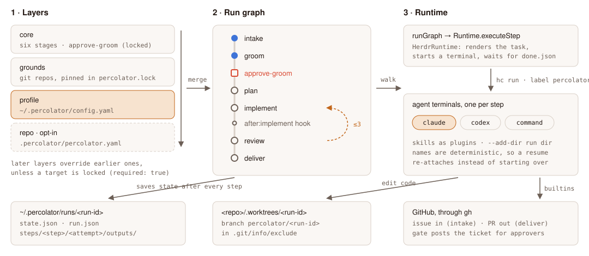

<p align="center">
  <picture>
    <source media="(prefers-color-scheme: dark)" srcset="assets/mark-on-dark.svg">
    
  </picture>
</p>

<h1 align="center">Percolator</h1>

<p align="center"><b>Tickets in. Pull requests out.</b></p>

Percolator is a deterministic software factory. Point `perc` at a GitHub issue and it takes the ticket through a **pipeline** of fixed stages. The built-in `feature` pipeline runs intake, groom, plan, implement, review and deliver, and ends with a pull request; you can add pipelines of your own, each with its own stages, inputs and exit. You choose the agent or builtin for each stage. A feature run stops for your approval after groom, and every run saves every step, so it can stop and pick up where it left off.

## What you need

**Required**

- **Node 24** or later, and **git**. Windows, Linux and macOS all work.
- **[`gh`](https://cli.github.com)**, logged in (`gh auth login`). Intake reads the issue, the gate posts to it and the exit acts through it: it opens the PR, or posts the comment, opens the issues, publishes the release, posts the review or opens the PR in an advisory's private fork (see [Exits](#exits)).
- **`hc`**, Herdr's terminal CLI. Every step runs in a terminal it starts.
- **The agent CLIs your config names:** `claude` for the example config, `codex`, or any command.

**Optional**

- **The [Herdr](https://herdr.dev) app**, for a Herdr space per run and the Percolator panel. Runs create a space by default, so without the app, set `runtime: { space: false }` in your profile. See [Integrations](#integrations).

Percolator isn't on npm yet: install it from a checkout as in [Local development](#local-development), and use `node <checkout>/src/cli.ts` wherever this README says `perc`.

## Quick start

| | Command | What it does |
|---|---|---|
| 1 | `perc init` | Writes an example config to `~/.percolator/config.yaml`. Edit it freely. |
| 2 | `perc validate` | Loads the config, resolves and pins grounds, and prints the graph each pipeline's run would walk. |
| 3 | `perc run owner/repo#42` | Starts a run of the default pipeline, `feature`. It stops once, after groom, for you to approve the ticket. |

`perc run` starts the run's driver in a terminal of its own. With Herdr, the driver stays out of the run's space, and the panel's **Driver pane ↗** peeks at it; closing the peek leaves the run going. Add `--foreground` to drive it in yours. `perc status` lists runs and `perc status <id>` shows one. `perc delete <id>…` removes the runs you name, and `perc delete --finished` every completed or failed one; both keep the branch. Delete also ends any terminal still open in the run's worktree, such as the shell its Herdr space starts, since that would hold the folder. Run `perc --help` for every command and its options.

> [!IMPORTANT]
> **Before your first run with `claude` agents,** trust the repo and `~/.percolator` once in Claude Code. Each agent starts with `--add-dir ~/.percolator/runs/<run-id>` to read its task and write its outputs. If that folder is not trusted, Claude Code asks whether to trust it, and answering no ends the agent and pauses the run.

## A run, stop by stop

A run walks the stages of its pipeline in order. You choose what runs at each stage, but a run cannot skip or reorder them. This section follows the `feature` pipeline, the one `perc init` sets up; [Pipelines](#pipelines) shows how to add others. One gate is built into `feature`: after groom, the run waits for you.

<picture>
  <source media="(prefers-color-scheme: dark)" srcset="assets/diagram-run-dark.svg">
  
</picture>

The diagram shows the example config mid-run: intake and groom are done, and the run waits at the `approve-groom` gate. Rejecting with feedback re-runs groom. Review can send work back to implement for up to 3 rounds; after the third, it delivers anyway. Hooks, like the one after implement, are optional nodes you add `before` or `after` any stage, or `all`. The `pr-description` hook before deliver writes the pull request text.

| Stop | What can run there | Done when |
|---|---|---|
| **intake** | builtin `github.intake` | The issue is read and the run has a ticket. |
| **groom … review** | an `agent`, `script` or `builtin` node, or a list of them | The step wrote `done.json` and its `outputs/<key>.md`. |
| **approve-groom** | `gate`, built in and locked, always after groom (in `feature` only) | You approve, locally or with a `/percolator approve` comment on the issue. The gate keeps one comment on the issue and edits it each round; rejected rounds stay in a collapsed history, and approval adds "Approved by @you". A rejection re-runs groom, 3 times at most. |
| **deliver** | builtin `github.open_pr` | The branch is pushed and the PR is open. Its body is `Closes #N`, followed by the `pr_body` output if a step wrote one. |

## The engine

Nothing in Percolator is improvised at run time. The config is merged into a graph before the first step starts, the graph is fixed for the whole run, and each step's result is written to disk before the next step begins.

<picture>
  <source media="(prefers-color-scheme: dark)" srcset="assets/diagram-engine-dark.svg">
  
</picture>

The layers merge into one graph per pipeline: its stages, your hooks and bounded back-edges (loops back to an earlier stage, with a round cap). `runGraph` hands each step to the runtime and saves state after it. A step counts as done only when it has written `done.json` and its outputs. The terminal's status is used only to notice an agent that needs you.

Each run works in its own git worktree at `<repo>/.worktrees/<run-id>`, on a branch named `percolator/<run-id>`. The worktree is inside the repo, so the repo's agent trust covers it, and Percolator lists `.worktrees/` in `.git/info/exclude` so it never shows up in `git status`.

**Deterministic**

- The graph is built and validated before the first step.
- Grounds are pinned to a commit in `percolator.lock`.
- Run ids, terminal names, posted comments and what an exit creates are stable or marked, so a resume finds them instead of duplicating them.

**Bounded**

- Every loop has a round cap. Review delivers at its cap, and a stage that loops through `max_rounds` on its binding moves on at its cap; an `on_fail` back-edge pauses the run and escalates to you.
- `perc resume` on a run paused at a cap grants exactly one more round.

## Integrations

`perc` is complete on its own: it starts runs, waits at gates and takes your answers on the command line. An integration adds a view on top. It reads `perc status --json`, a stable and versioned contract, and answers by running `perc` commands, as you would by hand. It never talks to the engine directly.

| Integration | Adds | Lives in |
|---|---|---|
| [Herdr](#herdr) | A space per run, a live board of runs, Approve / Reject / Resume / Delete buttons, notices | [`herdr/`](herdr/) |

### Herdr

The Herdr app adds a space per run, and the Percolator panel adds a live board of every run and buttons for the same commands. Agents run in terminals started by `hc` either way.

<picture>
  <source media="(prefers-color-scheme: dark)" srcset="assets/diagram-modes-dark.svg">
  
</picture>

To set it up:

1. Copy `herdr/layouts/percolator.json` and the two folders in `herdr/mods/` into `~/.config/herdr-app`.
2. Run `perc herdr link` once, so the panel knows which `node` and CLI to run.

For the full steps, keys and checks, see [`herdr/RECIPE.md`](herdr/RECIPE.md).

## Configuration

The config is `~/.percolator/config.yaml`, or the file you pass with `--config`. It holds **profiles**: each defines its **pipelines** (binds their stages and adds hook nodes), sets rules and pulls shared files from **grounds**. Every key is in `schema/percolator.schema.json`; point your editor at it for completion.

### Example config

This is what `perc init` writes:

```yaml
version: 1
profiles:
  default:
    match: { remote: "github.com/*/*" }     # which repos: globs host/owner/repo (or match.path)
    pipelines:
      feature:                              # tickets in, pull requests out
        default: true                       # what perc run uses without --pipeline
        bindings:
          intake: { builtin: github.intake }  # builtins are handled by Percolator itself
          groom:
            agent: claude                   # claude, codex or command
            model: opus
            skill: superpowers:brainstorming  # loaded as a plugin for claude; SKILL.md in the task otherwise
            prompt: |
              Let's brainstorm this ticket to make sure it matches expectations before we move on to planning or implementing it.
              Write the agreed ticket (goal, acceptance criteria, out of scope, open questions) as the groomed ticket, then stop: no plan and no code.
          plan:
            agent: claude
            model: opus
            skill: superpowers:writing-plans
          implement:
            agent: claude
            model: opus
            skills: [superpowers:executing-plans, superpowers:test-driven-development]
          review:
            agent: claude
            model: opus
            effort: medium                  # low … max, claude only
            skill: deep-dive-review
            max_rounds: 3                   # caps the review loop
          deliver: { builtin: github.open_pr }
        nodes:
          pr-description:                   # writes outputs/pr_body.md; deliver puts it under "Closes #N"
            agent: claude
            model: opus
            before: deliver
            prompt: |
              Write the pull request description for this run to {{outputs_dir}}/pr_body.md, in Markdown.
              Cover what changed and why, from the implement summary in the inputs and the diff (git diff {{base}}...HEAD in {{worktree}}).
              Say in one line how self-review ended (the latest review findings are in the inputs), but do not copy the findings.
              List the grounds the run was built under, from groundVersions in {{run_dir}}/state.json.
              Do not write "Closes #…": Percolator adds it. Do not push, open the PR or comment on the issue; Percolator opens the PR with this text.
              Finish with status pass, even if you could not write a description; Percolator then opens the PR with only "Closes #…".

      # A second pipeline, commented out: stages you name, ending in an exit (see Pipelines).
      # dd-alert:
      #   description: Diagnose a Datadog alert and write a report
      #   ticket: none                 # runs without an issue
      #   inputs:
      #     alert_url: { required: true, description: Link to the alert }   # perc run --input alert_url=<url>
      #   stages: [intake, gather, diagnose, report]   # intake first; the last stage is the exit
      #   outputs:
      #     gather: [evidence]         # each stage must write outputs/<key>.md
      #     diagnose: [diagnosis]
      #   exit: none                   # the outputs stay in the run dir; nothing is posted
      #   bindings:
      #     gather: { agent: claude, model: sonnet, prompt: … }
      #     diagnose: { agent: claude, model: opus, prompt: … }
```

### Profiles

```yaml
profiles:
  work:
    match: { remote: "github.com/acme/*" }
    tracker: { kind: github, approvers: [alice, bob] }
    use:
      - { from: team, file: graph.yaml, as: graph }   # the team's bindings, nodes and rules (see Grounds)
  personal:
    match: { path: "~/src/**" }
    runtime: { space: false }
    bindings: { … }                                    # as in the example config
```

Profiles are checked in order; the first whose `match.remote` or `match.path` fits the repo wins, and `--profile <name>` picks one by hand. Each profile must bind every stage of each of its pipelines (for `feature`, all six), itself, through a `graph` ground or through the profile it extends. Bindings and nodes written at the top of a profile, as in the `personal` and `acme` examples, belong to `feature`; when one profile sets the same stage or node in both places, `pipelines.feature` wins.

```yaml
profiles:
  acme:                                   # above default, which would also match acme's repos
    extends: default
    match: { remote: "github.com/acme/*" }
    tracker: { kind: github, approvers: [bob] }
    bindings:
      implement: { agent: codex }         # replaces default's implement binding whole
  default:
    match: { remote: "github.com/*/*" }
    bindings: { … }
```

`extends` starts a profile from another one: that profile's pipelines, bindings, nodes, rules and `use` come first as their own layer, so this profile replaces a stage's binding or a node by name (as a whole: restate any key it should keep) and adds mappings, and a `required: true` there still locks. `tracker` and `runtime` are inherited unless this profile sets them, each as a whole block. `match` and `trust_repo_config` are never inherited. One level only: a profile cannot extend one that extends another.

`tracker.approvers` lists the GitHub logins whose `/percolator approve` or `/percolator reject` comments count at a gate. Without it, only the GitHub user running `perc` counts. Local `perc approve`/`reject` record your `gh` login (the OS user if gh is not logged in).

| `runtime` key | What it does |
|---|---|
| `base` | Branch the run starts from and opens its PR against. Detected from the repo when left out. |
| `worktree_root` | Put worktrees here instead of `<repo>/.worktrees/`. |
| `keep_terminals` | Keep step terminals open after they finish. |
| `space` | `false` skips creating a Herdr space per run. |

> [!TIP]
> **Let an agent edit it.** Percolator ships a `percolator-config` skill (`skills/percolator-config/SKILL.md`). Give it to your agent and ask for the change you want: it edits the YAML, then runs `perc validate` until the config is clean.

### Node fields

| Field | For | What it does |
|---|---|---|
| `kind` | all | `agent`, `builtin`, `script` or `gate`. Inferred from `agent`, `builtin` or `command` when left out. |
| `agent` `model` `effort` `skill` `skills` | agent | Which agent runs the step, and with what. Rejected on any other kind. |
| `prompt` | agent | Inline text, or `{ from: <ground>, file: … }`. |
| `builtin` | builtin | `github.intake`, or on the exit stage the builtin of an exit, such as `github.open_pr` (see [Exits](#exits)). |
| `command` | script | An argv array, never a shell string. `{run_dir}`, `{outputs_dir}` and `{worktree}` are filled in. |
| `before` / `after` | nodes | Hook point: a stage, or `all`. At most one of the two. |
| `on_fail` | nodes | `{ back_to: <earlier stage>, max_rounds: n }`: a bounded back-edge. `n` counts failed rounds, the first run included, so `1` escalates on the first fail. |
| `max_rounds` | a stage's binding | Round cap for the review loop (default 3). On another stage's binding it makes that stage loop back to the one before it. |
| `once` | hooks | Skip the hook once it has passed in this run, so a loop does not re-run it. |
| `timeout_s` | agent, script | Escalate to you if the step is not done after n seconds. Builtins and gates ignore it. |
| `when_output` | gate | Stop only when an earlier step wrote this output (like `issues`); otherwise the gate passes at once. Rejected on any other kind. |
| `required` | all | Locks the node: later layers may only restate it unchanged. |

### Hooks, gates and loops

```yaml
profiles:
  default:
    nodes:
      audit:
        command: [pnpm, audit, --prod]
        after: implement
        on_fail: { back_to: implement, max_rounds: 2 }
      sign-off:
        kind: gate
        after: plan
```

- `audit` runs after implement. If it fails, the run goes back to implement once; if it fails again (two failed rounds), the run pauses and escalates to you.
- `sign-off` adds a second human gate after plan, which you answer the same way as `approve-groom`.
- `back_to` must point to an earlier stage. A `before: all` hook cannot loop.
- `before`/`after` must name a stage of the node's own pipeline, or `all`.
- Any step that writes a `pr_body` output sets the PR description; the last one in run order wins.

### Pipelines

A pipeline is a named list of stages, what runs each one, the inputs a run takes and how it ends. `feature` is built in; every other pipeline lists its own stages under `pipelines:`.

```yaml
profiles:
  default:
    pipelines:
      feature: { default: true, bindings: { … }, nodes: { … } }    # as in the example config
      hotfix:
        description: Small fix, no grooming                       # shown by perc pipelines
        inputs:
          severity: { required: true, description: sev1 … sev3 }
        stages: [intake, implement, review, deliver]
        exit: pr
        bindings:
          implement: { agent: claude, model: opus, prompt: "Fix the issue. Severity: {{input_severity}}." }
          review: { agent: claude, model: sonnet, max_rounds: 2 }
```

| Key | What it does |
|---|---|
| `stages` | The stages in order. `intake` comes first and the last one is the exit stage. Required for every pipeline but `feature`, whose stages are fixed. |
| `bindings` / `nodes` | What runs each stage, and the pipeline's hooks and gates, as for `feature`. `intake` left unbound runs `github.intake`; the exit stage left unbound runs the builtin of `exit`. The exit stage is never an agent. |
| `outputs` | Per stage, the output keys it must write (`outputs/<key>.md`). A stage left out needs none; `feature`'s stages keep their fixed outputs, and the exit stage writes its exit's output. |
| `exit` | How the run ends: `pr`, `comment`, `issue`, `none`, `release`, `pr_review` or `private_fork_pr` (see [Exits](#exits)). Optional when the last stage is bound to an exit builtin; when both are set they must agree. |
| `inputs` | Named values a run takes with `--input <name>=<value>`; `required: true` refuses a run without it, `description` is the hint. Prompts read them as `{{input_<name>}}`. |
| `ticket` | `required` (default), `optional` or `none`. |
| `default` | `true` on the pipeline `perc run` uses without `--pipeline`; at most one per profile. Without one, `feature` is the default. |
| `description` | One line on what the pipeline is for. |
| `rules` / `use` | Rules and mappings for this pipeline only. |
| `required` | Locks the pipeline's own keys (all but `bindings`, `nodes`, `rules` and `use`): later layers may only restate them. |

Pipeline names are lower-case letters, digits and `-` (at most 24 characters); input names are lower-case letters, digits and `_`.

- **Loops.** A stage named `review` loops back to the stage before it, 3 rounds unless its binding sets `max_rounds`; any other stage loops the same way when its binding sets `max_rounds`.
- **Gates.** `approve-groom` belongs to `feature`. Another pipeline has no built-in gate; add one as a node with `kind: gate` where you want to decide.
- **Outputs.** Each step's outputs reach the steps after it as inputs, so a stage reads what the stages before it wrote.
- **Tickets.** A pipeline with `ticket: none` refuses a ticket, and this version of `perc` cannot start it yet (`perc run` says so); `perc validate` still checks it.

`perc validate` checks every pipeline of the profile and prints one block per pipeline; `perc validate --pipeline hotfix` checks just one. `perc pipelines` lists the pipelines a repo can use, one line each (`--json` for integrations):

```text
feature (default)  ticket required  exit pr  inputs -
hotfix  ticket required  exit pr  inputs severity
```

### Exits

The last stage of a pipeline is its exit: a builtin that Percolator runs itself, never an agent. It reads what earlier stages wrote, acts on GitHub through `gh`, and writes one output. Each one marks what it creates, so a resume after a crash finds it instead of creating it twice.

| `exit` | Builtin | What it does | What it needs | Writes | Found again on resume by |
|---|---|---|---|---|---|
| `pr` | `github.open_pr` | Pushes the run branch and opens a PR against the base: `Closes #N`, then the `pr_body` output if a step wrote one. | Nothing | `pr_url` | The open PR for the run branch |
| `comment` | `github.comment` | Posts the `comment` output on the run's issue. | A ticket (`ticket: none` is refused); a stage before it writes `comment.md`, else the step escalates | `comment_url` | `<!-- percolator:exit run=<id> step=<step> -->` in the comment, which it then edits |
| `issue` | `github.open_issues` | Opens one issue per `## <title>` section of the `issues` output, in the run's repo. With no `issues` output, or no sections, it opens nothing and the run ends done. | Nothing | `issue_urls` (one URL per line) | `<!-- percolator:issue run=<id> n=<i> -->` in each issue, and `created.json` in the step dir |
| `none` | `percolator.report` | Nothing: the run ends, and its outputs stay in the run dir until `perc delete` removes them. | Nothing | Nothing | Nothing to find |
| `release` | `github.release` | Pushes the run branch and publishes a GitHub release of its head commit. The tag is the `tag` output, else input `tag`; the notes are the `release_notes` output. | Input `tag`, or `tag` under `outputs` of an earlier stage | `release_url` | The release with that tag |
| `pr_review` | `github.pr_review` | Posts the `review` output on the pull request in input `pr`, as a comment review: never approve or request changes. | Input `pr` (`#123`, `owner/repo#123` or a pull request URL); a stage before it writes `review.md` | `review_url` | `<!-- percolator:review run=<id> -->` in the review |
| `private_fork_pr` | `github.private_fork_pr` | Creates the temporary private fork of the security advisory in input `advisory`, pushes the run branch there and opens the PR in it, with the `pr_body` output and no `Closes #N`, so the fix stays private until the advisory is published. | Input `advisory`, a GHSA id (`GHSA-xxxx-xxxx-xxxx`) | `pr_url` | `fork.json` in the step dir, then the open PR for the run branch in the fork |

`perc validate` refuses an exit whose needs the pipeline does not declare, for example:

```text
exit pr_review needs input "pr" (the pull request to review); declare it under pipelines.<name>.inputs
```

### Starting a run

```sh
perc run owner/repo#42                                        # the default pipeline
perc run owner/repo#42 --pipeline hotfix --input severity=sev2
```

`--pipeline <name>` picks the pipeline; without it the run uses the profile's default. `--input key=value` gives one input; repeat it for each. The value is everything after the first `=`, so it may hold `=`, spaces or a path. Before creating anything, `perc run` refuses an input the pipeline does not declare, a missing required input, and a ticket on a `ticket: none` pipeline (usage errors, exit code 2), and a pipeline the profile does not have.

### Grounds: shared policy from git

```yaml
grounds:
  team: { git: https://github.com/acme/factory, ref: v3 }
  local: { path: ~/src/policies }
profiles:
  default:
    use:
      - { from: team, file: security.md, as: policy, applies_to: [implement, review], required: true }
      - { from: team, dir: skills, as: skills }
      - { from: team, file: graph.yaml, as: graph }
```

A ground is a git repo at a ref, or a local path. `perc validate` pins each git ground to a commit in `percolator.lock`; `--update` moves the pins.

`use` maps a file or dir into the run `as` one of `policy`, `context`, `skills`, `plugins`, `prompt` or `graph`. A `graph` mapping is a whole config fragment: its bindings, nodes and rules become a layer.

### Rules and locks

```yaml
rules:
  allowed_agents: [claude]
  allowed_models: [opus, sonnet]
  max_rounds_ceiling: 3
  require_skills:
    - { stage: implement, skills: [superpowers:test-driven-development] }
  required_nodes:
    - { name: audit, after: implement }
```

Rules check the merged graph, so a team ground can set what every profile must do: which agents and models are allowed, which skills a stage must load, and which nodes must exist. Top-level `rules` apply to every pipeline; `pipelines.<name>.rules` to that pipeline only.

Layers merge in order: core, then grounds, then your profile, then the repo. A later layer replaces a stage's binding or a node by name, and rules from every layer all apply. A target marked `required: true` is locked: later layers may only restate it unchanged.

<picture>
  <source media="(prefers-color-scheme: dark)" srcset="assets/diagram-layers-dark.svg">
  
</picture>

Changing a locked target fails validation:

```text
~/.percolator/config.yaml:14: profiles.default.nodes.audit: locked by ~/.percolator/grounds/team@3f2a9c1e04b7/graph.yaml:5 (required: true); remove this node or restate it exactly
```

> [!NOTE]
> **Repo config is opt-in.** A repo can carry `.percolator/percolator.yaml` as the last layer. That file can add nodes that run commands, so Percolator ignores it unless the profile sets `trust_repo_config: true`.

## Steering a run

Anything that needs you shows up in `perc status`, and in any [integration](#integrations) you use; the Percolator panel leaves an agent blocked in its terminal to Herdr's own agent status (the last row).

<picture>
  <source media="(prefers-color-scheme: dark)" srcset="assets/diagram-lifecycle-dark.svg">
  
</picture>

| You see | Why | Answer |
|---|---|---|
| **your turn · approve-groom** | The groomed ticket is ready. | `perc approve <id>` or `perc reject <id> "what to change"`, or an approver replies `/percolator approve` or `/percolator reject <what to change>` on the issue |
| **paused · review at cap** | A back-edge used all its rounds. | `perc resume <id>` grants one more round |
| **paused · plan** | A step escalated: it timed out, or twice finished without the outputs its stage needs. | Read its step dir, then `perc resume <id>` re-runs the step |
| **failed · implement** | A step failed and has no loop to go back through. | A failed run can't be resumed: read its step dir, then `perc delete <id>` (or `perc clean <id>` to keep the record) and start a new run |
| **stalled · driver stopped** | The driver terminal exited mid-run. | `perc resume <id>` |
| **agent blocked** (in `perc status` and in Herdr's own agent status; the Percolator panel counts the run as running) | The agent is asking something in its terminal. | Answer it in the agent's terminal |

Each step's files are in `~/.percolator/runs/<run-id>/steps/<step>/<attempt>/`: its `done.json` and its `outputs/`. `perc clean` removes the worktree and terminals but keeps this record and the branch; `perc delete` removes the record too and keeps only the branch.

## Local development

You need Node 24 or later and pnpm 12 or later. From a checkout, run perc with `node src/cli.ts`:

```sh
git clone https://github.com/Zidious/percolator
cd percolator
pnpm install --frozen-lockfile
node src/cli.ts --help
node src/cli.ts init
node src/cli.ts run Zidious/percolator#8
```

Exit codes: `0` ok, `1` error or failed run, `2` usage.

To contribute, see [`AGENTS.md`](AGENTS.md) for the test and build commands, the hard rules and the code layout.
