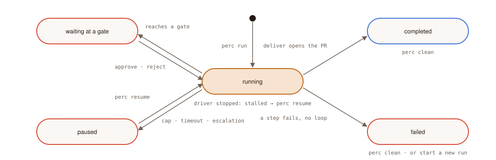

<p align="center">
  <picture>
    <source media="(prefers-color-scheme: dark)" srcset="assets/mark-on-dark.svg">
    
  </picture>
</p>

<h1 align="center">Percolator</h1>

<p align="center"><b>Tickets in. Pull requests out.</b></p>

Percolator is a deterministic software factory. Point `perc` at a GitHub issue and it takes the ticket through a **pipeline** of fixed stages. The built-in `feature` pipeline runs intake, groom, plan, implement, review and deliver, and ends with a pull request; you can add pipelines of your own, each with its own stages, inputs and exit, with or without a ticket. A run starts from `perc run` (or the Herdr panel, which runs it for you), from a triage router that hands a ticket to the pipeline that fits, or from a trigger (a schedule, a label, a pull request, a failed check) while `perc watch` runs. One stage can fan out: each slice of a plan runs through the rest of the pipeline in its own linked run and ends in its own PR. You choose the agent or builtin for each stage. A feature run stops for your approval after groom, and every run saves every step, so it can stop and pick up where it left off.

## What you need

**Required**

- **Node 24** or later, and **git**. Windows, Linux and macOS all work.
- **[`gh`](https://cli.github.com)**, logged in (`gh auth login`). Intake reads the issue, the gate posts to it and the exit acts through it: it opens the PR, or posts the comment, opens the issues, publishes the release, posts the review or opens the PR in an advisory's private fork (see [Exits](#exits)). `perc watch` polls issues, pull requests and workflow runs through it.
- **`hc`**, Herdr's terminal CLI. Every step runs in a terminal it starts.
- **The agent CLIs your config names:** `claude` for the example config, `codex`, or any command.

**Optional**

- **The [Herdr](https://herdr.dev) app**, for a Herdr space per run and the Percolator panel. Runs create a space by default, so without the app, set `runtime: { space: false }` in your profile. See [Integrations](#integrations).

Percolator isn't on npm yet: install it from a checkout as in [Local development](#local-development), and use `node <checkout>/src/cli.ts` wherever this README says `perc`.

## Quick start

| | Command | What it does |
|---|---|---|
| 1 | `perc init` | Writes an example config to `~/.percolator/config.yaml`. Edit it freely. |
| 2 | `perc validate` | Loads the config, resolves and pins grounds, and prints the graph each pipeline's run would walk. |
| 3 | `perc run owner/repo#42` | Starts a run of the default pipeline, `feature`. It stops once, after groom, for you to approve the ticket. |

`perc run` starts the run's driver in a terminal of its own. With Herdr, the driver stays out of the run's space, and the panel's **Driver pane ↗** peeks at it; closing the peek leaves the run going. Add `--foreground` to drive it in yours. `perc status` lists runs and `perc status <id>` shows one. `perc delete <id>…` removes the runs you name, and `perc delete --finished` every completed or failed one; both keep the branch. Delete also ends any terminal still open in the run's worktree, such as the shell its Herdr space starts, since that would hold the folder. Run `perc --help` for every command and its options.

> [!IMPORTANT]
> **Before your first run with `claude` agents,** trust the repo and `~/.percolator` once in Claude Code. Each agent starts with `--add-dir ~/.percolator/runs/<run-id>` to read its task and write its outputs. If that folder is not trusted, Claude Code asks whether to trust it, and answering no ends the agent and pauses the run.

## A run, stop by stop

A run walks the stages of its pipeline in order. You choose what runs at each stage, but a run cannot skip or reorder them. This section follows the `feature` pipeline, the one `perc init` sets up; [Pipelines](#pipelines) shows how to add others. One gate is built into `feature`: after groom, the run waits for you.

<picture>
  <source media="(prefers-color-scheme: dark)" srcset="assets/diagram-run-dark.svg">
  
</picture>

The diagram shows the example config mid-run: intake and groom are done, and the run waits at the `approve-groom` gate. Rejecting with feedback re-runs groom. Review can send work back to implement for up to 3 rounds; after the third, it delivers anyway. Hooks, like the one after implement, are optional nodes you add `before` or `after` any stage, or `all`. The `pr-description` hook before deliver writes the pull request text.

| Stop | What can run there | Done when |
|---|---|---|
| **intake** | builtin `github.intake` | The issue is read and the run has a ticket. |
| **groom … review** | an `agent`, `script` or `builtin` node, or a list of them | The step wrote `done.json` and its `outputs/<key>.md`. |
| **approve-groom** | `gate`, built in and locked, after groom (in `feature` only; a `feature` whose own `stages` leave out groom has none) | You approve, locally or with a `/percolator approve` comment on the issue. The gate keeps one comment on the issue and edits it each round; rejected rounds stay in a collapsed history, and approval adds "Approved by @you". A rejection re-runs groom, 3 times at most. |
| **deliver** | builtin `github.open_pr` | The branch is pushed and the PR is open. Its body is `Closes #N`, followed by the `pr_body` output if a step wrote one. |

## The engine

Nothing in Percolator is improvised at run time. The config is merged into a graph before the first step starts, the graph is fixed for the whole run, and each step's result is written to disk before the next step begins.

<picture>
  <source media="(prefers-color-scheme: dark)" srcset="assets/diagram-engine-dark.svg">
  
</picture>

The layers merge into one graph per pipeline: its stages, your hooks and bounded back-edges (loops back to an earlier stage, with a round cap). `runGraph` hands each step to the runtime and saves state after it. A step counts as done only when it has written `done.json` and its outputs. The terminal's status is used only to notice an agent that needs you.

Each run works in its own git worktree at `<repo>/.worktrees/<run-id>`, on a branch named `percolator/<run-id>`. The worktree is inside the repo, so the repo's agent trust covers it, and Percolator lists `.worktrees/` in `.git/info/exclude` so it never shows up in `git status`.

**Deterministic**

- The graph is built and validated before the first step. A router does not change its own graph: it hands the ticket to a new, linked run (see [Triage](#triage)). A fan-out does not either: each slice is a linked run of its own (see [Fan-out](#fan-out)).
- Grounds are pinned to a commit in `percolator.lock`.
- Run ids, terminal names, posted comments and what an exit creates are stable or marked, so a resume finds them instead of duplicating them.

**Bounded**

- Every loop has a round cap. Review delivers at its cap, and a stage that loops through `max_rounds` on its binding moves on at its cap; an `on_fail` back-edge pauses the run and escalates to you.
- `perc resume` on a run paused at a cap grants exactly one more round.

## Integrations

`perc` is complete on its own: it starts runs, waits at gates and takes your answers on the command line. An integration adds a view on top. It reads `perc status --json`, a stable and versioned contract (and `perc pipelines --json` to offer the pipelines a run can start on), and answers by running `perc` commands, as you would by hand. It never talks to the engine directly.

`perc status --json` is at `schema: 2`. Each run carries its `pipeline` and `inputs`; `ticket` is `null` on a ticketless run; `parent` is the run that started it (a router's, an `issue` exit's with `next`, or a fan-out's), or `null`; `children` lists the runs it started, with their pipeline and status (a fan-out's slices first, by index, each with `slice: { index, title }`, and `status: pending` for a slice whose run has not started yet); and `opened` lists the issues its exit opened. A run's `attention` says what it needs from you: a `message`, and the `actions` an integration may offer; at a `pick-pipeline` gate those are `pick` and `reject`, with the pipelines to pick from in `choices`. Beside `runs`, `watcher` says whether `perc watch` is running: `alive`, `since` (when it started, only while alive) and the `repos` it watches. An integration that reads schema 1 must be updated.

| Integration | Adds | Lives in |
|---|---|---|
| [Herdr](#herdr) | A space per run, a live board of runs and the runs they started (fan-out slices included), Approve / Reject / Resume / Delete and Run `<pipeline>` buttons, **+ New run** and **▸ Run next…** to start runs (the pipelines come from `perc pipelines --json`), the watcher's state with Start watcher / Stop, notices | [`herdr/`](herdr/) |

### Herdr

The Herdr app adds a space per run, and the Percolator panel adds a live board of every run and buttons for the same commands. Agents run in terminals started by `hc` either way.

- **Start a run.** **+ New run** in the title bar opens the start picker, and a finished run offers **▸ Run next…** on its ticket (see [Starting a run](#starting-a-run)).
- **Pipelines.** A run on a pipeline other than `feature` shows a chip with the pipeline's name after its title, and its spine draws that pipeline's own stages.
- **Linked runs.** A run that another one started shows `↳ from #42` under its title (the parent's ticket, or the parent's pipeline when the ticket is the run's own or there is none); a fan-out's slice shows `↳ slice 2 of #42: <title>` instead (`↳ slice 2 of <pipeline>: <title>` when the parent has no ticket). A run that started others shows `→ 3 runs`; a fan-out parent shows `→ 4 slices · 2 started` while some slices have not started, then `→ 4 slices`. Clicking the line selects that run (the parent, or the first run it started that is listed). On the board, a router's completed run has the state line `Routed → <pipeline>`, and a completed ticketless run with no PR and no opened issues (whatever its exit) the line `Done`. Selected, such a run's outcome box says `ROUTED → <pipeline>` or `DONE`.
- **Slices.** Under a fan-out parent's fan-out stage, each slice has a row: its status dot, `<i>.`, its title, the step it is at (`Done`, `Not started`, the current step, or its status) and a `PR ↗` link once it has one. Clicking a row selects that slice's run; a slice that has not started has no run to select yet.
- **Pick a pipeline.** At a router's `pick-pipeline` gate, the message names the agent's suggestion when it made one, and the panel shows one **Run `<name>`** button per pipeline the router may pick; each runs `perc approve <id> --pipeline <name>`. **Reject** has the agent pick again.
- **The watcher.** The title bar shows whether `perc watch` runs: `Watching 2 repos`; `Starting…` after **Start watcher** until its first heartbeat (at most 60 s; no button meanwhile); `Watcher not responding` when its heartbeat is stale but the `percolator-watch` terminal is still live (with **Stop**); else `Not watching`. **Stop** runs `perc watch stop`; **Start watcher** runs `perc watch` with a `--repo` for every repo earlier runs used, so it is not offered before the first run.

<picture>
  <source media="(prefers-color-scheme: dark)" srcset="assets/diagram-modes-dark.svg">
  
</picture>

To set it up:

1. Copy `herdr/layouts/percolator.json` and the two folders in `herdr/mods/` into `~/.config/herdr-app`.
2. Run `perc herdr link` once, so the panel knows which `node` and CLI to run.

For the full steps, keys and checks, see [`herdr/RECIPE.md`](herdr/RECIPE.md).

## Configuration

The config is `~/.percolator/config.yaml`, or the file you pass with `--config`. It holds **profiles**: each defines its **pipelines** (binds their stages and adds hook nodes), sets rules and pulls shared files from **grounds**. Every key is in `schema/percolator.schema.json`; point your editor at it for completion.

### Example config

This is what `perc init` writes:

```yaml
# Percolator config, written by `perc init`. Edit freely.
# Schema for editor completion and validation: the Percolator package's schema/percolator.schema.json
version: 1
profiles:
  default:
    match: { remote: "github.com/*/*" }     # which repos: globs host/owner/repo (or match.path)
    pipelines:
      feature:                              # tickets in, pull requests out: intake, groom, plan, implement, review, deliver
        default: true                       # what perc run uses without --pipeline
        bindings:
          intake: { builtin: github.intake }  # builtins are handled by Percolator itself
          groom:
            agent: claude                   # claude, codex or command
            model: opus
            skill: superpowers:brainstorming  # loaded as a plugin for claude; SKILL.md in the task otherwise
            prompt: |
              Let's brainstorm this ticket to make sure it matches expectations before we move on to planning or implementing it.
              Write the agreed ticket (goal, acceptance criteria, out of scope, open questions) as the groomed ticket, then stop: no plan and no code.
          plan:
            agent: claude
            model: opus
            skill: superpowers:writing-plans
          implement:
            agent: claude
            model: opus
            skills: [superpowers:executing-plans, superpowers:test-driven-development]
          review:
            agent: claude
            model: opus
            effort: medium                  # low … max, claude only
            skill: deep-dive-review
            max_rounds: 3                   # caps the review loop
          deliver: { builtin: github.open_pr }
        nodes:
          pr-description:                   # writes outputs/pr_body.md; deliver puts it under "Closes #N"
            agent: claude
            model: opus
            before: deliver
            prompt: |
              Write the pull request description for this run to {{outputs_dir}}/pr_body.md, in Markdown.
              Cover what changed and why, from the implement summary in the inputs and the diff (git diff {{base}}...HEAD in {{worktree}}).
              Say in one line how self-review ended (the latest review findings are in the inputs), but do not copy the findings.
              List the grounds the run was built under, from groundVersions in {{run_dir}}/state.json.
              Do not write "Closes #…": Percolator adds it. Do not push, open the PR or comment on the issue; Percolator opens the PR with this text.
              Finish with status pass, even if you could not write a description; Percolator then opens the PR with only "Closes #…".

      # A second pipeline: stages you name, ending in an exit. Uncomment and adapt it, then
      # check it with: perc validate --pipeline dd-alert
      # dd-alert:
      #   description: Diagnose a Datadog alert and write a report
      #   ticket: none                 # runs without an issue
      #   inputs:
      #     alert_url: { required: true, description: Link to the alert }   # perc run --input alert_url=<url>
      #   stages: [intake, gather, diagnose, report]   # intake first; the last stage is the exit
      #   outputs:
      #     gather: [evidence]         # each stage must write outputs/<key>.md
      #     diagnose: [diagnosis]
      #   exit: none                   # the outputs stay in the run dir; nothing is posted
      #   bindings:
      #     gather:
      #       agent: claude
      #       model: sonnet
      #       prompt: Collect the logs, metrics and recent deploys behind {{input_alert_url}} into evidence.md.
      #     diagnose:
      #       agent: claude
      #       model: opus
      #       prompt: From the evidence in the inputs, find the likely cause and write it to diagnosis.md.

      # A short pipeline for small fixes, and a triage router that sends each ticket to feature or hotfix.
      # Uncomment both, then: perc validate --pipeline triage
      # hotfix:
      #   description: Small fix, no grooming
      #   stages: [intake, implement, review, deliver]
      #   exit: pr
      #   bindings:
      #     implement: { agent: claude, model: opus, skill: superpowers:test-driven-development }
      #     review: { agent: claude, model: sonnet, skill: deep-dive-review, max_rounds: 2 }
      # triage:
      #   description: Read the ticket and hand it to the pipeline that fits
      #   router: true                 # the last stage, route, starts a linked run of the pipeline it picks
      #   stages: [intake, route]
      #   routes:
      #     - { label: bug, to: hotfix }   # label rules are tried first, in order
      #   choose:                      # then this agent picks, writing pick.md
      #     agent: claude
      #     model: sonnet
      #     from: [feature, hotfix]
      #     confirm: unsure            # stop at the pick-pipeline gate only when the agent is unsure (or: always)
      #   fallback: feature            # used when nothing picked a pipeline
      #   triggers:
      #     - { label: triage }        # while perc watch runs, each issue labelled triage starts a triage run

      # A pipeline that plans once, then implements, reviews and delivers each slice of the plan in its own
      # linked run and PR, three at a time. Uncomment it, then: perc validate --pipeline epic
      # epic:
      #   description: Plan a big ticket, then build each slice in its own PR
      #   stages: [intake, plan, implement, review, deliver]
      #   exit: pr
      #   outputs:
      #     plan: [plan]
      #   fan_out:
      #     stage: implement           # implement and every stage after it run once per slice
      #     slices: { from: plan, output: slices }   # plan writes slices.md: one "## <title>" section per slice
      #     max_parallel: 3            # slices running at once (default 3)
      #   bindings:
      #     plan:
      #       agent: claude
      #       model: opus
      #       skill: superpowers:writing-plans
      #       prompt: Write the plan to plan.md, and split the work into independent slices in slices.md, one "## <title>" section each.
      #     implement: { agent: claude, model: opus, skills: [superpowers:executing-plans, superpowers:test-driven-development] }
      #     review: { agent: claude, model: opus, skill: deep-dive-review, max_rounds: 3 }
```

### Profiles

```yaml
profiles:
  work:
    match: { remote: "github.com/acme/*" }
    tracker: { kind: github, approvers: [alice, bob] }
    use:
      - { from: team, file: graph.yaml, as: graph }   # the team's bindings, nodes and rules (see Grounds)
  personal:
    match: { path: "~/src/**" }
    runtime: { space: false }
    bindings: { … }                                    # as in the example config
```

Profiles are checked in order; the first whose `match.remote` or `match.path` fits the repo wins, and `--profile <name>` picks one by hand. Each profile must bind every stage of each of its pipelines (for `feature`, all six, or every stage it lists), itself, through a `graph` ground or through the profile it extends. Bindings and nodes written at the top of a profile, as in the `personal` and `acme` examples, belong to `feature`; when one profile sets the same stage or node in both places, `pipelines.feature` wins.

```yaml
profiles:
  acme:                                   # above default, which would also match acme's repos
    extends: default
    match: { remote: "github.com/acme/*" }
    tracker: { kind: github, approvers: [bob] }
    bindings:
      implement: { agent: codex }         # replaces default's implement binding whole
  default:
    match: { remote: "github.com/*/*" }
    bindings: { … }
```

`extends` starts a profile from another one: that profile's pipelines, bindings, nodes, rules and `use` come first as their own layer, so this profile replaces a stage's binding or a node by name (as a whole: restate any key it should keep) and adds mappings, and a `required: true` there still locks. `tracker` and `runtime` are inherited unless this profile sets them, each as a whole block. `match` and `trust_repo_config` are never inherited. One level only: a profile cannot extend one that extends another.

`tracker.approvers` lists the GitHub logins whose `/percolator approve` or `/percolator reject` comments count at a gate. Without it, only the GitHub user running `perc` counts. Local `perc approve`/`reject` record your `gh` login (the OS user if gh is not logged in).

| `runtime` key | What it does |
|---|---|
| `base` | Branch the run starts from and opens its PR against. Detected from the repo when left out. |
| `worktree_root` | Put worktrees here instead of `<repo>/.worktrees/`. |
| `keep_terminals` | Keep step terminals open after they finish. |
| `space` | `false` skips creating a Herdr space per run. |

> [!TIP]
> **Let an agent edit it.** Percolator ships a `percolator-config` skill (`skills/percolator-config/SKILL.md`). Give it to your agent and ask for the change you want: it edits the YAML, then runs `perc validate` until the config is clean.

### Node fields

| Field | For | What it does |
|---|---|---|
| `kind` | all | `agent`, `builtin`, `script` or `gate`. Inferred from `agent`, `builtin` or `command` when left out. |
| `agent` `model` `effort` `skill` `skills` | agent | Which agent runs the step, and with what. Rejected on any other kind. |
| `prompt` | agent | Inline text, or `{ from: <ground>, file: … }`. |
| `builtin` | builtin | `github.intake`, or on the exit stage the builtin of an exit, such as `github.open_pr` (see [Exits](#exits)). |
| `command` | script | An argv array, never a shell string. `{run_dir}`, `{outputs_dir}` and `{worktree}` are filled in. |
| `before` / `after` | nodes | Hook point: a stage, or `all`. At most one of the two. |
| `on_fail` | nodes | `{ back_to: <earlier stage>, max_rounds: n }`: a bounded back-edge. `n` counts failed rounds, the first run included, so `1` escalates on the first fail. |
| `max_rounds` | a stage's binding | Round cap for the review loop (default 3). On another stage's binding it makes that stage loop back to the one before it. |
| `once` | hooks | Skip the hook once it has passed in this run, so a loop does not re-run it. |
| `timeout_s` | agent, script | Escalate to you if the step is not done after n seconds. Builtins and gates ignore it. |
| `when_output` | gate | Stop only when an earlier step wrote this output (like `issues`); otherwise the gate passes at once. Rejected on any other kind. |
| `required` | all | Locks the node: later layers may only restate it unchanged. |

### Hooks, gates and loops

```yaml
profiles:
  default:
    nodes:
      audit:
        command: [pnpm, audit, --prod]
        after: implement
        on_fail: { back_to: implement, max_rounds: 2 }
      sign-off:
        kind: gate
        after: plan
```

- `audit` runs after implement. If it fails, the run goes back to implement once; if it fails again (two failed rounds), the run pauses and escalates to you.
- `sign-off` adds a second human gate after plan, which you answer the same way as `approve-groom`.
- `back_to` must point to an earlier stage. A `before: all` hook cannot loop.
- `before`/`after` must name a stage of the node's own pipeline, or `all`.
- Any step that writes a `pr_body` output sets the PR description; the last one in run order wins.

### Pipelines

A pipeline is a named list of stages, what runs each one, the inputs a run takes and how it ends. `feature` is built in; every other pipeline lists its own stages under `pipelines:`.

```yaml
profiles:
  default:
    pipelines:
      feature: { default: true, bindings: { … }, nodes: { … } }    # as in the example config
      hotfix:
        description: Small fix, no grooming                       # shown by perc pipelines
        inputs:
          severity: { required: true, description: sev1 … sev3 }
        stages: [intake, implement, review, deliver]
        exit: pr
        bindings:
          implement: { agent: claude, model: opus, prompt: "Fix the issue. Severity: {{input_severity}}." }
          review: { agent: claude, model: sonnet, max_rounds: 2 }
```

| Key | What it does |
|---|---|
| `stages` | The stages in order. `intake` comes first and the last one is the exit stage. Required for every pipeline but `feature`, which runs its six stages unless it lists its own; a `feature` whose `stages` leave out groom has no `approve-groom` gate. |
| `bindings` / `nodes` | What runs each stage, and the pipeline's hooks and gates, as for `feature`. On every pipeline but `feature`, `intake` left unbound runs `github.intake` and the exit stage left unbound runs the builtin of `exit`; `feature` binds every stage itself, even with its own `stages`. The exit stage is never an agent. |
| `outputs` | Per stage, the output keys it must write (`outputs/<key>.md`). A stage left out needs none, except groom, plan, implement and review, which keep their feature outputs unless listed; `feature`'s stages keep their fixed outputs, and the exit stage writes its exit's output. |
| `exit` | How the run ends: `pr`, `comment`, `issue`, `none`, `release`, `pr_review` or `private_fork_pr` (see [Exits](#exits)). Optional when the last stage is bound to an exit builtin; when both are set they must agree. |
| `inputs` | Named values a run takes with `--input <name>=<value>`; `required: true` refuses a run without it, `description` is the hint. Prompts read them as `{{input_<name>}}`. |
| `ticket` | `required` (default), `optional` or `none`. |
| `router` `routes` `choose` `fallback` | Make the pipeline a triage router, which hands the ticket to another pipeline (see [Triage](#triage)). |
| `next` | On a pipeline with `exit: issue`: each issue it opens starts a linked run of this pipeline (see [Exits](#exits)). |
| `triggers` | What starts runs of the pipeline while `perc watch` runs (see [Triggers and perc watch](#triggers-and-perc-watch)). |
| `fan_out` | `{ stage, slices: { from, output }, max_parallel }`: run `stage` and every stage after it once per `## ` section of the `output` that the earlier stage `from` writes, each slice in its own linked run, at most `max_parallel` (default 3) at a time (see [Fan-out](#fan-out)). |
| `default` | `true` on the pipeline `perc run` uses without `--pipeline`; at most one per profile. Without one, `feature` is the default. |
| `description` | One line on what the pipeline is for. |
| `rules` / `use` | Rules and mappings for this pipeline only. |
| `required` | Locks the pipeline's own keys (all but `bindings`, `nodes`, `rules` and `use`): later layers may only restate them. |

Pipeline names start with a lower-case letter, then lower-case letters, digits and `-` (at most 24 characters); input names start with a lower-case letter, then lower-case letters, digits and `_` (at most 32 characters). `all`, `before-all` and `after-all` are reserved and cannot be stage names.

- **Loops.** A stage named `review` loops back to the stage before it, 3 rounds unless its binding sets `max_rounds`; any other stage loops the same way when its binding sets `max_rounds`.
- **Gates.** `approve-groom` belongs to `feature`, after its groom stage. Another pipeline has no built-in gate; add one as a node with `kind: gate` where you want to decide.
- **Outputs.** Each step's outputs reach the steps after it as inputs, so a stage reads what the stages before it wrote.
- **Tickets.** A pipeline with `ticket: none` refuses a ticket and runs on its inputs alone: its intake writes them as the ticket (`ticket.md`, an `## Inputs` list), so later stages read them as they would read an issue. The run id, branch and Herdr space take the pipeline's name where a ticket run has the issue number (`dd-alert-20261122-…`), a PR it opens has no `Closes #N`, and its gates are answered with `perc approve`/`perc reject` or the panel, since there is no issue to comment on. It names its repository from the clone's `origin`; an SSH origin that uses a host alias from your SSH config (`git@gh-work:o/r`) names the host the alias connects to, as `ssh -G` reports it (the watcher and a bare `#123` ticket do the same). With `ticket: optional`, a ticket is fetched when one is given.

`perc validate` checks every pipeline of the profile and prints one block per pipeline; `perc validate --pipeline hotfix` checks just one. `perc pipelines [--repo <dir>] [--profile <name>]` lists the pipelines a repo can use, the default first, one line each:

```text
feature (default)  ticket required  exit pr  inputs -
hotfix  ticket required  exit pr  inputs severity
```

With `--json` it is the contract the Herdr panel's start picker reads (`schema: 1`): the `repo` and `profile` it read, then each pipeline's `name`, `default`, `router`, `ticket`, `inputs` (name, required, description), `exit` (one of the kinds under [Exits](#exits), or `route` for a router), `description`, and the `steps` and `loops` its preview draws; a pipeline that fails validation is listed with its `error` instead.

### Exits

The last stage of a pipeline is its exit: a builtin that Percolator runs itself, never an agent. It reads what earlier stages wrote, acts on GitHub through `gh`, and writes one output. Each one marks what it creates, so a resume after a crash finds it instead of creating it twice.

| `exit` | Builtin | What it does | What it needs | Writes | Found again on resume by |
|---|---|---|---|---|---|
| `pr` | `github.open_pr` | Pushes the run branch and opens a PR against the base: `Closes #N`, then the `pr_body` output if a step wrote one. | Nothing | `pr_url` | The open PR for the run branch |
| `comment` | `github.comment` | Posts the `comment` output on the run's issue. | A ticket on every run (`ticket: none` or `optional` is refused); a stage before it writes `comment.md`, else the step escalates | `comment_url` | `<!-- percolator:exit run=<id> step=<step> -->` in the comment, which it then edits |
| `issue` | `github.open_issues` | Opens one issue per `## <title>` section of the `issues` output, in the run's repo. With no `issues` output, or no sections, it opens nothing and the run ends done. A section with a bare `## ` heading escalates with `github.open_issues: draft <n> in issues.md has no title (a bare "## " heading); give it a title and resume`. | Nothing | `issue_urls` (one URL per line) | `<!-- percolator:issue run=<id> n=<i> -->` in each issue, and `created.json` in the step dir |
| `none` | `percolator.report` | Nothing: the run ends, and its outputs stay in the run dir until `perc delete` removes them. | Nothing | Nothing | Nothing to find |
| `release` | `github.release` | Pushes the run branch and publishes a GitHub release of its head commit. The tag is the `tag` output, else input `tag`; the notes are the `release_notes` output. | Input `tag`, or `tag` under `outputs` of an earlier stage | `release_url` | `<!-- percolator:release run=<id> -->` in the release notes of the release with that tag; a tag that another release already has escalates with `github.release: tag "<t>" already has a release (<url>); pick another tag and resume` |
| `pr_review` | `github.pr_review` | Posts the `review` output on the pull request in input `pr`, as a comment review: never approve or request changes. | Input `pr` (`#123`, `owner/repo#123` or a pull request URL); a stage before it writes `review.md` | `review_url` | `<!-- percolator:review run=<id> -->` in the review |
| `private_fork_pr` | `github.private_fork_pr` | Creates the temporary private fork of the security advisory in input `advisory`, pushes the run branch there and opens the PR in it, with the `pr_body` output and no `Closes #N`, so the fix stays private until the advisory is published. | Input `advisory`, a GHSA id (`GHSA-xxxx-xxxx-xxxx`) | `pr_url` | `fork.json` in the step dir, then the open PR for the run branch in the fork |

`perc validate` refuses an exit whose needs the pipeline does not declare, or declares without `required: true`, for example:

```text
exit pr_review needs input "pr" (the pull request to review); declare it under pipelines.<name>.inputs
```

A gate before the exit is the pipeline's choice. For example, to read the drafted issues before they are opened, add an `approve-issue` gate with `when_output`, so it stops only when there are drafts:

```yaml
pipelines:
  dd-alert:
    ticket: none
    inputs: { alert_url: { required: true } }
    stages: [intake, gather, diagnose, open]
    outputs: { gather: [evidence] }    # issues stays unlisted: diagnose may write no issues.md
    exit: issue
    next: triage                         # optional: each opened issue starts a linked triage run
    bindings:
      gather: { … }
      diagnose: { agent: claude, prompt: "… For each issue to open, a \"## <title>\" section in issues.md; none to open: no issues.md." }
    nodes:
      approve-issue:
        kind: gate
        before: open
        when_output: issues              # no drafts: the gate passes at once and the run ends done
        on_fail: { back_to: diagnose, max_rounds: 3 }   # a rejection redrafts
```

Leave `issues` out of `outputs`: an output listed there is required, so the gate would always stop. `next` is only for an `issue` exit, and it must name a pipeline that takes a ticket and has no required inputs (a `next` run gets none); a `next` that leads back to its own pipeline, directly or through other pipelines' `next`, is refused. Each new issue gets its own linked run, recorded in the exit's `created.json` before it starts, so a resume starts only the ones still missing.

### Starting a run

```sh
perc run owner/repo#42                                        # the default pipeline
perc run owner/repo#42 --pipeline hotfix --input severity=sev2
perc run --pipeline dd-alert --input alert_url=https://app.datadoghq.com/…   # ticket: none, run from the repo's clone
```

`--pipeline <name>` picks the pipeline. Without it, a run on a ticket uses the pipeline the issue asks for: a `pipeline:<name>` label, else the latest `/percolator run <name>` comment by an approver, else the profile's default. Without a ticket or a flag, the default is used, and if that one needs a ticket, the run is a usage error. `--input key=value` gives one input; repeat it for each. The value is everything after the first `=`, so it may hold `=`, spaces or a path. Before creating anything, `perc run` refuses an input the pipeline does not declare, a missing required input, and a ticket on a `ticket: none` pipeline (usage errors, exit code 2), and a pipeline the profile does not have. Inputs reach prompts as `{{input_<name>}}`, and intake lists them under `## Inputs` in the ticket. `--repo <dir>` runs in that repo's clone instead of the current directory.

**From the Herdr panel.** The panel starts the same `perc run`, never through `perc watch`:

- **+ New run** in the title bar (a `+` under 800px wide, the words from 800px) opens the start picker. Pick the pipeline first: the default is preselected, and each one shows its tags (`Default`, `No ticket`, `Ticket optional`) and its description. Then come the fields that pipeline asks for: a ticket field when it takes a ticket (a URL or `owner/repo#n`), and one field per input, its description as the placeholder. Last is the repo: one of the repos earlier runs used, or **Choose folder…**; a typed ticket preselects the repo of the latest run on that GitHub repo.
- **▸ Run next…** in the header of a finished run, while no run on its ticket is live, opens the same picker on that run. It lists only the pipelines that take a ticket, and the ticket and repo are fixed: the run's own ticket, or a choice among it and the issues its `issue` exit opened.
- The picker shows the exact `perc run …` line it will run. **Start** stays disabled until the pipeline's needs are met, and says why: `Pick a repo`, `Enter a ticket`, `A ticket cannot start with -` or `Enter <input>`. Enter in a field starts and Esc cancels; once started, the new run is selected.
- The picked pipeline's preview (its stages, gates, hooks, loops and exit) sits below the picker, and to its right in a window from 720px wide.
- The Herdr commands `percolator.new` (or `percolator.new/<pipeline>`, with that pipeline picked), `percolator.next` and `percolator.start` do the same from a key binding. With the panel's fixtures, Start only says `Fixture: would run perc run …`.

A ticket has at most one live run (`running` or `paused`): starting another pipeline on it is refused until that run finishes or is deleted. The run a router starts on its ticket is linked to the router's run, so it is not refused while that one is still live; neither are a fan-out's slice runs, beside their parent and each other. A run on `feature` has the id `t<n>-<date>-<time>-<rand>`, on another pipeline `t<n>-<pipeline>-…`, without a ticket `<pipeline>-…`, and a fan-out's slice `<parent>-s<i>`.

### Triage

A router is a pipeline that reads the ticket and hands it to another pipeline. Set `router: true` and end its `stages` with `route`, as the `triage` example in the [example config](#example-config) does. The `route` stage is built in: it is never bound, and a router sets no `exit`. Mark the router `default: true` to send every `perc run <ticket>` without `--pipeline` through it.

| Key | What it does |
|---|---|
| `routes` | Label rules, `{ label, to }`, tried in order. |
| `choose` | The agent that picks when no rule matched: `agent`, `model`, `effort`, `skill(s)`, `prompt` as on a node, `from` (the pipelines it may pick) and `confirm`: `unsure` (default) stops at the `pick-pipeline` gate only when the agent says it is unsure, `always` stops every time. |
| `fallback` | The pipeline used when nothing picked one. Default: the profile's default, or `feature` when the default is the router. |

The route step decides in this order and stops at the first answer:

1. **Named.** The issue names a pipeline: a `pipeline:<name>` label, or an approver's `/percolator run <name>` comment. A name the router cannot hand the ticket to (a `ticket: none` pipeline, or one with required inputs) is ignored, and the next step decides. (Naming one with `perc run --pipeline` skips the router altogether.)
2. **Rule.** The first `routes` rule whose label the issue has.
3. **Agent.** The `choose` agent writes `pick.md`: `pipeline: <name>`, `unsure: true|false`, then its reasons. A pick outside `from` counts as unsure. A sure pick goes ahead on its own; an unsure one (or every one, with `confirm: always`) waits at the `pick-pipeline` gate.
4. **Fallback.** `fallback`, when the agent made no valid pick and you approved without naming one, or when the router has no `choose`.

The decision goes to `route.json` in the run dir (`pipeline`, `by`: named, rule, agent, gate or fallback, and why), with the id of the child run, **before** that run starts, so a resume finds the child instead of starting a second one. The child is a new run of the chosen pipeline on the same ticket, linked to the router's run: the router's `route` output says `Routed to <pipeline> (<by>: <why>) → run <child>`, and `perc status --json` lists it under the router's `children` and gives the child's `parent`. The router's run completes once the child has started; the work goes on in the child. `perc delete` of the router's run leaves the child alone.

At the `pick-pipeline` gate:

| Answer | What happens |
|---|---|
| `perc approve <id>` | The agent's pick goes ahead, or the fallback when it made no valid pick. `perc status` names the pick: "pick the pipeline for this ticket (the agent suggests hotfix)". |
| `perc approve <id> --pipeline <name>` | `<name>` instead; it must be one of `choose.from`. `--pipeline` answers only a `pick-pipeline` gate. The panel's **Run `<name>`** buttons run this. |
| `perc reject <id> "<feedback>"` | The agent picks again with your feedback, 3 rounds at most. |

`perc validate` checks the routes across the profile: every `to`, `choose.from` entry and `fallback` must be a pipeline of the profile that takes a ticket, is not itself a router and has no required inputs (a route passes none: `… takes required inputs a <router|next> cannot pass; make them optional or route elsewhere`), and the router needs a ticket:

```text
router "triage" routes tickets, but pipeline "dd-alert" has ticket: none; route to a pipeline that takes a ticket
```

### Triggers and perc watch

`triggers` on a pipeline start runs of it without you. They fire only while `perc watch` runs: it polls each repo through `gh` and starts one run per firing, exactly as `perc run` would. Nothing fires while it is stopped, and nothing it missed is made up later, except that a schedule fires once for its latest missed time within the last 7 days.

```yaml
pipelines:                # only the keys triggers need; stages, bindings and exit as usual
  nightly:
    ticket: none
    inputs: { area: { required: true } }
    triggers:
      - { schedule: "0 6 * * 1-5", timezone: Europe/London, inputs: { area: deps } }
  triage:
    triggers:
      - { label: triage }
  review-pr:
    ticket: none
    inputs: { pr: { required: true } }
    triggers:
      - { pr_opened: { not_author: [alice] } }
      - { dependabot: true }
  fix-ci:
    ticket: none
    inputs: { branch: { required: true }, run_url: { required: true } }
    triggers:
      - { check_failed: { branch: main, workflow: ci.yml } }
```

| Trigger | Starts a run | The run gets | The pipeline needs |
|---|---|---|---|
| `schedule: "<cron>"` | On each matching minute: five fields (minute, hour, day of month, month, day of week; `*`, numbers, ranges, lists, `/steps`; 0 or 7 is Sunday), in `timezone` (an IANA name; default the machine's). | No ticket; the trigger's `inputs`. | `ticket: none` or `optional`; the `inputs` cover its required inputs. |
| `label: <name>` | Once for each open issue with the label, unless the issue already has a live run. | The issue as its ticket. | A ticket (`required` or `optional`). |
| `pr_opened: true` or `{ not_author: [<login>…] }` | On each open pull request (skipping those authors). | Input `pr`: the PR's URL. | `ticket: none` or `optional`, and input `pr`. |
| `dependabot: true` | On each open Dependabot pull request. | Input `pr`. | `ticket: none` or `optional`, and input `pr`. |
| `check_failed: { branch, workflow? }` | On each failed workflow run on the branch (of that workflow file only, when set), and again when a re-run of it fails. | Inputs `branch` and `run_url`. | `ticket: none` or `optional`, and inputs `branch` and `run_url`. |

`perc validate` refuses a pull request or check trigger on a pipeline that needs a ticket, for example:

```text
~/.percolator/config.yaml:31: profiles.default.pipelines.review-pr.triggers.0: a pr_opened trigger starts runs without a ticket; set ticket: none or ticket: optional
```

```sh
perc watch --repo ~/src/app --repo ~/src/api   # default: the current directory; --interval <s>, default 60, at least 15
perc watch stop
```

`perc watch` starts the watcher in its own hc terminal, `percolator-watch` (labelled `percolator.role=watcher`), and returns; `--foreground` runs it in yours. Each poll validates each repo's config (a broken one is logged and skipped until it is fixed) and writes a heartbeat to `~/.percolator/watch/watch.json`. `perc watch stop` ends that terminal. A second `perc watch` while one runs is refused. `perc status --json` reports the watcher under `watcher`: alive while its process runs on this machine and its heartbeat is fresh. The Herdr panel shows it, with a Start watcher / Stop button (see [Herdr](#herdr)).

Every firing has a key (the issue, PR, workflow run or schedule time it is for) and goes in the firing ledger, `~/.percolator/watch/fired.json`, with its run id **before** the run starts. So each firing starts exactly one run, even when the watcher is restarted; one that crashed before its run started is retried with the same id. The first time a schedule is polled, it only records the time, so a new watcher does not start runs for times before it began; likewise each time the watcher starts, its first poll of a `pr_opened`, `dependabot` or `check_failed` trigger records the pull requests and failed runs already there (including those that appeared while it was stopped) without starting runs (a `label` trigger does start runs for issues labelled before the watcher began). A firing whose run you deleted with `perc delete` is not started again. A `label` trigger fires once per issue; to ask for another run, remove the label and add it again while the watcher runs (a closed issue re-arms the same way, so reopening one that still has the label starts a run). An issue that already has a live run when it is labelled starts nothing, now or when that run finishes. `perc run` never goes through the watcher. A schedule fires once per watched repo whose config has it. The watcher knows a trigger by its settings, not its place in the list: reordering triggers changes nothing, while editing one makes it a new trigger, whose first poll only records what is there (a `label` trigger still fires for labelled issues).

### Fan-out

`fan_out` runs one stage, and every stage after it, once per slice, each slice in its own linked run. Use it when an earlier stage (say `plan`) splits the work into parts that can be built, reviewed and delivered on their own: the `epic` example in the [example config](#example-config) opens one PR per slice.

```yaml
pipelines:
  epic:
    stages: [intake, plan, implement, review, deliver]
    exit: pr
    fan_out:
      stage: implement                       # neither intake nor the exit stage
      slices: { from: plan, output: slices } # a stage before it, and the output key it writes
      max_parallel: 3                        # default 3
    bindings: { … }
```

- **Slices.** Each `## <title>` section of the `slices` output (`slices.md`) is one slice, in order. The output becomes a required output of the `from` stage, so it need not be listed under `outputs`.
- **The parent.** The run walks the stages before `stage`, then a fan-out step. That step writes the split to `fanout.json` in the run dir (each slice's index, run id and title) and starts the slice runs, keeping at most `max_parallel` unfinished at a time. It waits until every slice has finished, then completes with the `slices_done` output, one line per slice: `<i>. <title> → <PR url or status>`. The parent runs no exit of its own.
- **The slices.** Slice `i` is the run `<parent>-s<i>`, in its own worktree on branch `percolator/<parent>-s<i>`, from the parent's base. Its intake is a seed step: it copies the parent's latest outputs and its issue (so each slice's PR says `Closes #N`) and writes `slice.md`, the slice's title and section. Then it runs from `stage` through the exit. A loop in it may go back only to `stage` or later; `perc validate` refuses one that goes back further (`profiles.default.pipelines.epic.nodes.test.on_fail.back_to: test loops back to plan, which runs before the fan-out at implement; loop back to implement or later`). So `stage` cannot be a stage that loops, such as `review`, which goes back to the stage before it every round: `review loops back to implement every round, so it cannot start a fan-out slice; set fan_out.stage to implement or an earlier stage`.
- **Resume.** A resume of the parent reuses `fanout.json` and never splits again. It leaves finished slices alone and restarts the driver of an unfinished slice whose driver is gone.
- **Escalations.** If `from` wrote no `## ` sections, the parent pauses with `percolator.fan_out: plan wrote no slices (## <title> sections in slices.md); fix the output and resume`; if a section has no title, with `percolator.fan_out: slice 2 in slices.md has no title (a bare "## " heading); give it a title and resume`. If a slice run is deleted while the parent waits on it, the parent pauses with `percolator.fan_out: slice(s) <parent>-s2 deleted while running; perc resume <parent> to start it again`. If a slice pauses (an escalation or a gate) and no other slice is running, the parent pauses too, since nothing moves until the slice is answered: `percolator.fan_out: slice(s) <parent>-s2 paused; answer each (perc status <id>), then perc resume <parent>`. If a slice fails, the parent pauses once every slice has finished, naming the failed ones: `percolator.fan_out: slice(s) <parent>-s2 failed; perc delete each (its branch stays), then perc resume <parent> to run it again`. A failed run cannot be resumed, so run `perc delete <parent>-s<i>`, then `perc resume <parent>`: the parent starts that slice again, on its branch.
- **Status.** `perc status --json` lists the slices first among the parent's `children`, with their `slice` index and title (see [Integrations](#integrations)); the Herdr panel shows one row per slice under the fan-out stage (see [Herdr](#herdr)).
- **Delete.** `perc delete` of the parent leaves its slice runs; delete them by id.

`perc validate` prints the parent's block, whose steps end in the fan-out step (`implement: builtin percolator.fan_out`), then what each slice run walks, so you can check the slice steps and loops:

```text
slice runs (fan-out of implement, at most 3 at a time):
steps:
1. intake: builtin percolator.seed
2. implement: claude, model opus, skills superpowers:executing-plans, superpowers:test-driven-development
3. review: claude, model opus, skills deep-dive-review
4. deliver: builtin github.open_pr

back-edges:
review → implement (max 3, continue)
```

To send only big tickets through fan-out, keep it on its own pipeline and point a [router](#triage) at it, with a `routes` rule such as `{ label: epic, to: epic }` or `epic` in `choose.from`.

### Grounds: shared policy from git

```yaml
grounds:
  team: { git: https://github.com/acme/factory, ref: v3 }
  local: { path: ~/src/policies }
profiles:
  default:
    use:
      - { from: team, file: security.md, as: policy, applies_to: [implement, review], required: true }
      - { from: team, dir: skills, as: skills }
      - { from: team, file: graph.yaml, as: graph }
```

A ground is a git repo at a ref, or a local path. `perc validate` pins each git ground to a commit in `percolator.lock`; `--update` moves the pins.

`use` maps a file or dir into the run `as` one of `policy`, `context`, `skills`, `plugins`, `prompt` or `graph`. A `graph` mapping is a whole config fragment: its pipelines, bindings, nodes and rules become a layer. So a team ground can ship whole pipelines: a later layer sets a pipeline's keys over the ground's, key by key, and binds or replaces its stages and nodes by name, unless the ground locked the pipeline with `required: true`.

### Rules and locks

```yaml
rules:
  allowed_agents: [claude]
  allowed_models: [opus, sonnet]
  max_rounds_ceiling: 3
  require_skills:
    - { stage: implement, skills: [superpowers:test-driven-development] }
  required_nodes:
    - { name: audit, after: implement }
```

Rules check the merged graph, so a team ground can set what every profile must do: which agents and models are allowed, which skills a stage must load, and which nodes must exist. `max_rounds_ceiling` caps every loop, not only review: a stage's `max_rounds` (review's default 3 included) and every `on_fail.max_rounds` above it are refused (`allows 5 review rounds, over max_rounds_ceiling 3 (from <where the rule is set>); set max_rounds to 3 or less`), and the built-in gates' rounds are clamped to it. Top-level `rules` apply to every pipeline; `pipelines.<name>.rules` to that pipeline only.

Layers merge in order: core, then grounds, then your profile, then the repo. A later layer replaces a stage's binding or a node by name, sets a pipeline's own keys over the earlier ones, and rules from every layer all apply. A target marked `required: true` (a binding, a node, a mapping, or a pipeline's own keys) is locked: later layers may only restate it unchanged.

<picture>
  <source media="(prefers-color-scheme: dark)" srcset="assets/diagram-layers-dark.svg">
  
</picture>

Changing a locked target fails validation:

```text
~/.percolator/config.yaml:14: profiles.default.nodes.audit: locked by ~/.percolator/grounds/team@3f2a9c1e04b7/graph.yaml:5 (required: true); remove this node or restate it exactly
```

> [!NOTE]
> **Repo config is opt-in.** A repo can carry `.percolator/percolator.yaml` as the last layer. That file can add nodes that run commands, so Percolator ignores it unless the profile sets `trust_repo_config: true`.

## Steering a run

Anything that needs you shows up in `perc status`, and in any [integration](#integrations) you use; the Percolator panel leaves an agent blocked in its terminal to Herdr's own agent status (the last row).

<picture>
  <source media="(prefers-color-scheme: dark)" srcset="assets/diagram-lifecycle-dark.svg">
  
</picture>

| You see | Why | Answer |
|---|---|---|
| **Your turn · approve-groom** | The groomed ticket is ready. | `perc approve <id>` or `perc reject <id> "what to change"`, or an approver replies `/percolator approve` or `/percolator reject <what to change>` on the issue |
| **Your turn · approve-issue** (any gate of a ticketless run) | A gate of a run without a ticket: "approve or reject here (no issue to comment on)". | `perc approve <id>` or `perc reject <id> "what to change"`, or the panel's buttons; there is no issue to reply on |
| **Your turn · pick-pipeline** | A router's agent is unsure of its pick (or the router has `confirm: always`): "pick the pipeline for this ticket (the agent suggests hotfix)". | `perc approve <id>` to take the pick, `perc approve <id> --pipeline <name>` to pick another (`perc status <id>` lists one such line per pipeline it may pick; the panel's **Run `<name>`** buttons), or `perc reject <id> "why"` to have the agent pick again (see [Triage](#triage)) |
| **Paused · implement** (a fan-out step) | A slice failed or is paused with none running, or the stage before it wrote no slices. | Fix the slices output and `perc resume <id>`; for a paused slice, answer it, then `perc resume <id>`; for a failed slice, `perc delete <id>-s<i>`, then `perc resume <id>` starts it again (see [Fan-out](#fan-out)) |
| **Paused · review at cap** | A back-edge used all its rounds. | `perc resume <id>` grants one more round |
| **Paused · plan** | A step escalated: it timed out, or twice finished without the outputs its stage needs. | Read its step dir, then `perc resume <id>` re-runs the step |
| **Failed · implement** (a fan-out slice) | A step of a slice run failed: "Delete this slice (its branch stays), then resume <parent> to run it again". | `perc delete <id>`, then `perc resume <parent>` starts the slice again on its branch |
| **Failed · implement** | A step failed and has no loop to go back through. | A failed run can't be resumed: read its step dir, then `perc delete <id>` (or `perc clean <id>` to keep the record) and start a new run |
| **Stalled · driver stopped** | The driver terminal exited mid-run. | `perc resume <id>` |
| **agent blocked** (in `perc status` and in Herdr's own agent status; the Percolator panel counts the run as running) | The agent is asking something in its terminal. | Answer it in the agent's terminal |

`perc approve` and `perc reject` answer only a run waiting at a gate; on any other run they say `run <id> is not waiting at a gate; see where it is with perc status <id>`.

Each step's files are in `~/.percolator/runs/<run-id>/steps/<step>/<attempt>/`: its `done.json` and its `outputs/`. `perc clean` removes the worktree and terminals but keeps this record and the branch; `perc delete` removes the record too and keeps only the branch.

## Local development

You need Node 24 or later and pnpm 12 or later. From a checkout, run perc with `node src/cli.ts`:

```sh
git clone https://github.com/Zidious/percolator
cd percolator
pnpm install --frozen-lockfile
node src/cli.ts --help
node src/cli.ts init
node src/cli.ts run Zidious/percolator#8
```

Exit codes: `0` ok, `1` error or failed run, `2` usage.

To contribute, see [`AGENTS.md`](AGENTS.md) for the test and build commands, the hard rules and the code layout.
