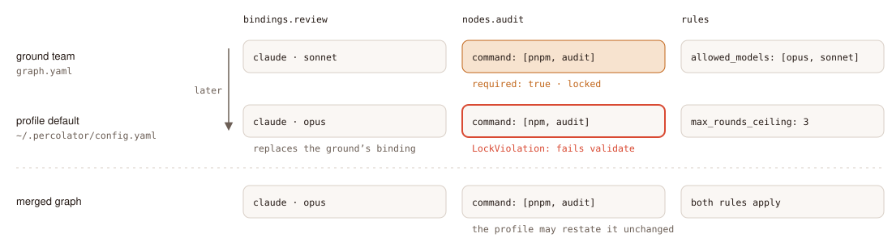

# Configuration

The config is `~/.percolator/config.yaml`, or the file you pass with `--config`. It holds **profiles**: each defines its **pipelines** (binds their stages and adds hook nodes), sets rules and pulls shared files from **grounds**. Every key is in `schema/percolator.schema.json`; point your editor at it for completion.

## Example config

This is what `perc init` writes:

```yaml
# Percolator config, written by `perc init`. Edit freely.
# Schema for editor completion and validation: the Percolator package's schema/percolator.schema.json
version: 1
profiles:
  default:
    match: { remote: "github.com/*/*" }     # which repos: globs host/owner/repo (or match.path)
    pipelines:
      feature:                              # tickets in, pull requests out: intake, groom, plan, implement, review, deliver
        default: true                       # what perc run uses without --pipeline
        bindings:
          intake: { builtin: github.intake }  # builtins are handled by Percolator itself
          groom:
            agent: claude                   # claude, codex or command
            model: opus
            skill: superpowers:brainstorming  # loaded as a plugin for claude; SKILL.md in the task otherwise
            prompt: |
              Let's brainstorm this ticket to make sure it matches expectations before we move on to planning or implementing it.
              Write the agreed ticket (goal, acceptance criteria, out of scope) as the groomed ticket, then stop: no plan and no code. If questions only the owner can answer are still open, don't leave them in the ticket: escalate with them (questions in done.json), and you will run again with the answers.
          plan:
            agent: claude
            model: opus
            skill: superpowers:writing-plans
          implement:
            agent: claude
            model: opus
            skills: [superpowers:executing-plans, superpowers:test-driven-development]
          review:
            agent: claude
            model: opus
            effort: medium                  # low … max, claude only
            skill: deep-dive-review
            max_rounds: 3                   # caps the review loop
          deliver: { builtin: github.open_pr }
        nodes:
          pr-description:                   # writes outputs/pr_body.md; deliver puts it under "Closes #N"
            agent: claude
            model: opus
            before: deliver
            prompt: |
              Write the pull request description for this run to {{outputs_dir}}/pr_body.md, in Markdown.
              Cover what changed and why, from the implement summary in the inputs and the diff (git diff {{base}}...HEAD in {{worktree}}).
              Say in one line how self-review ended (the latest review findings are in the inputs), but do not copy the findings.
              List the grounds the run was built under, from groundVersions in {{run_dir}}/state.json.
              Do not write "Closes #…": Percolator adds it. Do not push, open the PR or comment on the issue; Percolator opens the PR with this text.
              Finish with status pass, even if you could not write a description; Percolator then opens the PR with only "Closes #…".

      # A second pipeline: stages you name, ending in an exit. Uncomment and adapt it, then
      # check it with: perc validate --pipeline dd-alert
      # dd-alert:
      #   description: Diagnose a Datadog alert and write a report
      #   ticket: none                 # runs without an issue
      #   inputs:
      #     alert_url: { required: true, description: Link to the alert }   # perc run --input alert_url=<url>
      #   stages: [intake, gather, diagnose, report]   # intake first; the last stage is the exit
      #   outputs:
      #     gather: [evidence]         # each stage must write outputs/<key>.md
      #     diagnose: [diagnosis]
      #   exit: none                   # the outputs stay in the run dir; nothing is posted
      #   bindings:
      #     gather:
      #       agent: claude
      #       model: sonnet
      #       prompt: Collect the logs, metrics and recent deploys behind {{input_alert_url}} into evidence.md.
      #     diagnose:
      #       agent: claude
      #       model: opus
      #       prompt: From the evidence in the inputs, find the likely cause and write it to diagnosis.md.

      # A short pipeline for small fixes, and a triage router that sends each ticket to feature or hotfix.
      # Uncomment both, then: perc validate --pipeline triage
      # hotfix:
      #   description: Small fix, no grooming
      #   stages: [intake, implement, review, deliver]
      #   exit: pr
      #   bindings:
      #     implement: { agent: claude, model: opus, skill: superpowers:test-driven-development }
      #     review: { agent: claude, model: sonnet, skill: deep-dive-review, max_rounds: 2 }
      # triage:
      #   description: Read the ticket and hand it to the pipeline that fits
      #   router: true                 # the last stage, route, starts a linked run of the pipeline it picks
      #   stages: [intake, route]
      #   routes:
      #     - { label: bug, to: hotfix }   # label rules are tried first, in order
      #   choose:                      # then this agent picks, writing pick.md
      #     agent: claude
      #     model: sonnet
      #     from: [feature, hotfix]
      #     confirm: unsure            # stop at the pick-pipeline gate only when the agent is unsure (or: always)
      #   fallback: feature            # used when nothing picked a pipeline
      #   triggers:
      #     - { label: triage }        # while perc watch runs, each issue labelled triage starts a triage run

      # A pipeline that plans once, then implements, reviews and delivers each slice of the plan in its own
      # linked run and PR, three at a time. Uncomment it, then: perc validate --pipeline epic
      # epic:
      #   description: Plan a big ticket, then build each slice in its own PR
      #   stages: [intake, plan, implement, review, deliver]
      #   exit: pr
      #   outputs:
      #     plan: [plan]
      #   fan_out:
      #     stage: implement           # implement and every stage after it run once per slice
      #     slices: { from: plan, output: slices }   # plan writes slices.md: one "## <title>" section per slice
      #     max_parallel: 3            # slices running at once (default 3)
      #   bindings:
      #     plan:
      #       agent: claude
      #       model: opus
      #       skill: superpowers:writing-plans
      #       prompt: Write the plan to plan.md, and split the work into independent slices in slices.md, one "## <title>" section each.
      #     implement: { agent: claude, model: opus, skills: [superpowers:executing-plans, superpowers:test-driven-development] }
      #     review: { agent: claude, model: opus, skill: deep-dive-review, max_rounds: 3 }
```

## Profiles

```yaml
profiles:
  work:
    match: { remote: "github.com/acme/*" }
    tracker: { kind: github, approvers: [alice, bob] }
    use:
      - { from: team, file: graph.yaml, as: graph }   # the team's bindings, nodes and rules (see Grounds)
  personal:
    match: { path: "~/src/**" }
    runtime: { space: false }
    bindings: { … }                                    # as in the example config
```

Profiles are checked in order; the first whose `match.remote` or `match.path` fits the repo wins, and `--profile <name>` picks one by hand. Each profile must bind every stage of each of its pipelines (for `feature`, all six, or every stage it lists), itself, through a `graph` ground or through the profile it extends. Bindings and nodes written at the top of a profile, as in the `personal` and `acme` examples, belong to `feature`; when one profile sets the same stage or node in both places, `pipelines.feature` wins.

```yaml
profiles:
  acme:                                   # above default, which would also match acme's repos
    extends: default
    match: { remote: "github.com/acme/*" }
    tracker: { kind: github, approvers: [bob] }
    bindings:
      implement: { agent: codex }         # replaces default's implement binding whole
  default:
    match: { remote: "github.com/*/*" }
    bindings: { … }
```

`extends` starts a profile from another one: that profile's pipelines, bindings, nodes, rules and `use` come first as their own layer, so this profile replaces a stage's binding or a node by name (as a whole: restate any key it should keep) and adds mappings, and a `required: true` there still locks. `tracker` and `runtime` are inherited unless this profile sets them, each as a whole block. `match` and `trust_repo_config` are never inherited. One level only: a profile cannot extend one that extends another.

`tracker.approvers` lists the GitHub logins whose `/percolator approve` or `/percolator reject` comments count at a gate. Without it, only the GitHub user running `perc` counts. Local `perc approve`/`reject` record your `gh` login (the OS user if gh is not logged in).

| `runtime` key | What it does |
|---|---|
| `base` | Branch the run starts from and opens its PR against. Detected from the repo when left out. |
| `worktree_root` | Put worktrees here instead of `<repo>/.worktrees/`. |
| `keep_terminals` | Keep step terminals open after they finish. |
| `space` | `false` skips creating a Herdr space per run. |

> [!TIP]
> **Let an agent edit it.** Percolator ships a `percolator-config` skill (`skills/percolator-config/SKILL.md`). Give it to your agent and ask for the change you want: it edits the YAML, then runs `perc validate` until the config is clean.

## Node fields

| Field | For | What it does |
|---|---|---|
| `kind` | all | `agent`, `builtin`, `script` or `gate`. Inferred from `agent`, `builtin` or `command` when left out. |
| `agent` `model` `effort` `skill` `skills` | agent | Which agent runs the step, and with what. Rejected on any other kind. |
| `prompt` | agent | Inline text, or `{ from: <ground>, file: … }`. |
| `builtin` | builtin | `github.intake`, or on the exit stage the builtin of an exit, such as `github.open_pr` (see [Exits](pipelines.md#exits)). |
| `command` | script | An argv array, never a shell string. `{run_dir}`, `{outputs_dir}` and `{worktree}` are filled in. |
| `before` / `after` | nodes | Hook point: a stage, or `all`. At most one of the two. |
| `on_fail` | nodes | `{ back_to: <earlier stage>, max_rounds: n }`: a bounded back-edge. `n` counts failed rounds, the first run included, so `1` escalates on the first fail. A gate without it goes back to the stage it follows (`after: X` to X, `before: X` to the stage before X), 3 rounds at most; a gate after a looping stage's work (`after: review`) counts as a round of that loop, and one before it (`before: review`) goes back at once, before the stage runs. |
| `max_rounds` | a stage's binding | Round cap for the review loop (default 3). On another stage's binding it makes that stage loop back to the one before it. |
| `once` | hooks | Skip the hook once it has passed in this run, so a loop does not re-run it. |
| `timeout_s` | agent, script | Escalate to you if the step is not done after n seconds; its terminal keeps running, and `perc resume` re-attaches to it. Builtins and gates ignore it. |
| `when_output` | gate | Stop only when an earlier step wrote this output (like `issues`); otherwise the gate passes at once. Rejected on any other kind. |
| `required` | all | Locks the node: later layers may only restate it unchanged. |

## Hooks, gates and loops

```yaml
profiles:
  default:
    nodes:
      audit:
        command: [pnpm, audit, --prod]
        after: implement
        on_fail: { back_to: implement, max_rounds: 2 }
      sign-off:
        kind: gate
        after: plan
```

- `audit` runs after implement. If it fails, the run goes back to implement once; if it fails again (two failed rounds), the run pauses and escalates to you.
- `sign-off` adds a second human gate after plan, which you answer the same way as `approve-groom`. It has no `on_fail`, so rejecting it sends the run back to plan with your feedback, 3 rounds at most, then it escalates to you.
- A gate without `on_fail` must have a stage to go back to: `perc validate` refuses one `before: all`, `after: all` or `before: intake` (`gate "pre" runs before intake, so a reject has no earlier stage to go back to; attach it after intake or a later stage, or remove it`). It also refuses one after the exit stage (`after: deliver`, a gate after the exit in its binding, or `after: route` in a router), since a reject would deliver again: attach it before the exit stage, or give it an `on_fail`.
- **Upgrading:** before this release a rejected gate without `on_fail` failed the run, and such a gate was accepted anywhere. A config with one in a place refused above no longer validates: give it an `on_fail` or move it. A run started before the upgrade whose config has a gate without `on_fail` cannot be resumed (`run <id> was started with a different graph (its config or the Percolator version changed since); start a new run`): start it again with `perc run`.
- `back_to` must point to an earlier stage. A `before: all` hook cannot loop.
- `before`/`after` must name a stage of the node's own pipeline, or `all`.
- Any step that writes a `pr_body` output sets the PR description; the last one in run order wins.

## Grounds: shared policy from git

```yaml
grounds:
  team: { git: https://github.com/acme/factory, ref: v3 }
  local: { path: ~/src/policies }
profiles:
  default:
    use:
      - { from: team, file: security.md, as: policy, applies_to: [implement, review], required: true }
      - { from: team, dir: skills, as: skills }
      - { from: team, file: graph.yaml, as: graph }
```

A ground is a git repo at a ref, or a local path. `perc validate` pins each git ground to a commit in `percolator.lock`; `--update` moves the pins.

`use` maps a file or dir into the run `as` one of `policy`, `context`, `skills`, `plugins`, `prompt` or `graph`. A `graph` mapping is a whole config fragment: its pipelines, bindings, nodes and rules become a layer. So a team ground can ship whole pipelines: a later layer sets a pipeline's keys over the ground's, key by key, and binds or replaces its stages and nodes by name, unless the ground locked the pipeline with `required: true`.

## Rules and locks

```yaml
rules:
  allowed_agents: [claude]
  allowed_models: [opus, sonnet]
  max_rounds_ceiling: 3
  require_skills:
    - { stage: implement, skills: [superpowers:test-driven-development] }
  required_nodes:
    - { name: audit, after: implement }
```

Rules check the merged graph, so a team ground can set what every profile must do: which agents and models are allowed, which skills a stage must load, and which nodes must exist. `max_rounds_ceiling` caps every loop, not only review: a stage's `max_rounds` (review's default 3 included) and every `on_fail.max_rounds` above it are refused (`allows 5 review rounds, over max_rounds_ceiling 3 (from <where the rule is set>); set max_rounds to 3 or less`), and the built-in gates' rounds are clamped to it. Top-level `rules` apply to every pipeline; `pipelines.<name>.rules` to that pipeline only.

Layers merge in order: core, then grounds, then your profile, then the repo. A later layer replaces a stage's binding or a node by name, sets a pipeline's own keys over the earlier ones, and rules from every layer all apply. A target marked `required: true` (a binding, a node, a mapping, or a pipeline's own keys) is locked: later layers may only restate it unchanged.

<picture>
  <source media="(prefers-color-scheme: dark)" srcset="../assets/diagram-layers-dark.svg">
  
</picture>

Changing a locked target fails validation:

```text
~/.percolator/config.yaml:14: profiles.default.nodes.audit: locked by ~/.percolator/grounds/team@3f2a9c1e04b7/graph.yaml:5 (required: true); remove this node or restate it exactly
```

> [!NOTE]
> **Repo config is opt-in.** A repo can carry `.percolator/percolator.yaml` as the last layer. That file can add nodes that run commands, so Percolator ignores it unless the profile sets `trust_repo_config: true`.
