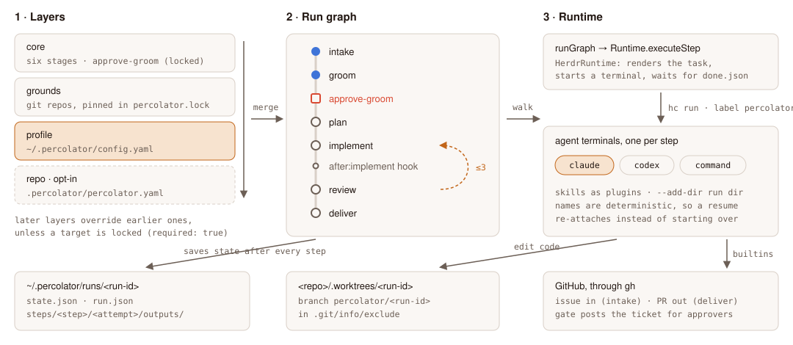

# The engine

Nothing in Percolator is improvised at run time. The config is merged into a graph before the first step starts, the graph is fixed for the whole run, and each step's result is written to disk before the next step begins.

<picture>
  <source media="(prefers-color-scheme: dark)" srcset="../assets/diagram-engine-dark.svg">
  
</picture>

The layers merge into one graph per pipeline: its stages, your hooks and bounded back-edges (loops back to an earlier stage, with a round cap). `runGraph` hands each step to the runtime and saves state after it. A step counts as done only when it has written `done.json` and its outputs. The terminal's status is used only to notice an agent that needs you.

Each run works in its own git worktree at `<repo>/.worktrees/<run-id>`, on a branch named `percolator/<run-id>`. The worktree is inside the repo, so the repo's agent trust covers it, and Percolator lists `.worktrees/` in `.git/info/exclude` so it never shows up in `git status`.

**Deterministic**

- The graph is built and validated before the first step. A router does not change its own graph: it hands the ticket to a new, linked run (see [Triage](pipelines.md#triage)). A fan-out does not either: each slice is a linked run of its own (see [Fan-out](pipelines.md#fan-out)).
- Grounds are pinned to a commit in `percolator.lock`.
- Run ids, terminal names, posted comments and what an exit creates are stable or marked, so a resume finds them instead of duplicating them.

**Bounded**

- Every loop has a round cap. Review delivers at its cap, and a stage that loops through `max_rounds` on its binding moves on at its cap; an `on_fail` back-edge pauses the run and escalates to you.
- `perc resume` on a run paused at a cap grants exactly one more round.
