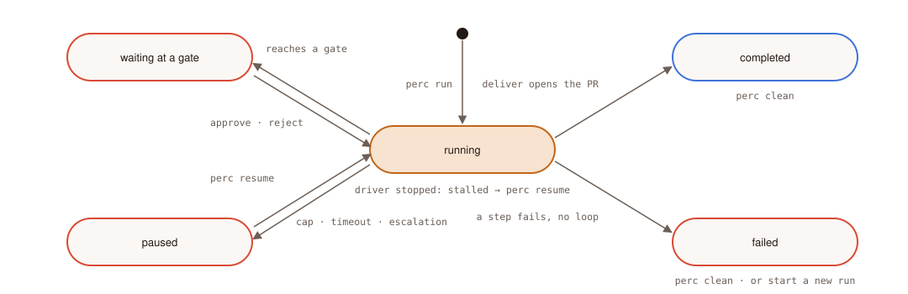

# Steering a run

Anything that needs you shows up in `perc status`, and in any [integration](integrations.md) you use; the Percolator panel leaves an agent blocked in its terminal to Herdr's own agent status (the last row).

<picture>
  <source media="(prefers-color-scheme: dark)" srcset="../assets/diagram-lifecycle-dark.svg">
  
</picture>

| You see | Why | Answer |
|---|---|---|
| **Your turn · approve-groom** | The groomed ticket is ready. | `perc approve <id>` or `perc reject <id> "what to change"`, or an approver replies `/percolator approve` or `/percolator reject <what to change>` on the issue |
| **Your turn · approve-issue** (any gate of a ticketless run) | A gate of a run without a ticket: "approve or reject here (no issue to comment on)". | `perc approve <id>` or `perc reject <id> "what to change"`, or the panel's buttons; there is no issue to reply on |
| **Your turn · pick-pipeline** | A router's agent is unsure of its pick (or the router has `confirm: always`): "pick the pipeline for this ticket (the agent suggests hotfix)". | `perc approve <id>` to take the pick, `perc approve <id> --pipeline <name>` to pick another (`perc status <id>` lists one such line per pipeline it may pick; the panel's **Run `<name>`** buttons), or `perc reject <id> "why"` to have the agent pick again (see [Triage](pipelines.md#triage)) |
| **Paused · implement** (a fan-out step) | A slice failed or is paused with none running, or the stage before it wrote no slices. | Fix the slices output and `perc resume <id>`; for a paused slice, answer it, then `perc resume <id>`; for a failed slice, `perc delete <id>-s<i>`, then `perc resume <id>` starts it again (see [Fan-out](pipelines.md#fan-out)) |
| **Paused · review at cap** | A back-edge used all its rounds. | `perc resume <id>` grants one more round |
| **Paused · plan** | A step escalated: it timed out, or twice finished without the outputs its stage needs. | Read its step dir, then `perc resume <id>` re-runs the step |
| **Failed · implement** (a fan-out slice) | A step of a slice run failed: "Delete this slice (its branch stays), then resume <parent> to run it again". | `perc delete <id>`, then `perc resume <parent>` starts the slice again on its branch |
| **Failed · implement** | A step failed and has no loop to go back through. | A failed run can't be resumed: read its step dir, then `perc delete <id>` (or `perc clean <id>` to keep the record) and start a new run |
| **Stalled · driver stopped** | The driver terminal exited mid-run. | `perc resume <id>` |
| **agent blocked** (in `perc status` and in Herdr's own agent status; the Percolator panel counts the run as running) | The agent is asking something in its terminal. | Answer it in the agent's terminal |

`perc approve` and `perc reject` answer only a run waiting at a gate; on any other run they say `run <id> is not waiting at a gate; see where it is with perc status <id>`.

Each step's files are in `~/.percolator/runs/<run-id>/steps/<step>/<attempt>/`: its `done.json` and its `outputs/`. `perc clean` removes the worktree and terminals but keeps this record and the branch; `perc delete` removes the record too and keeps only the branch.
