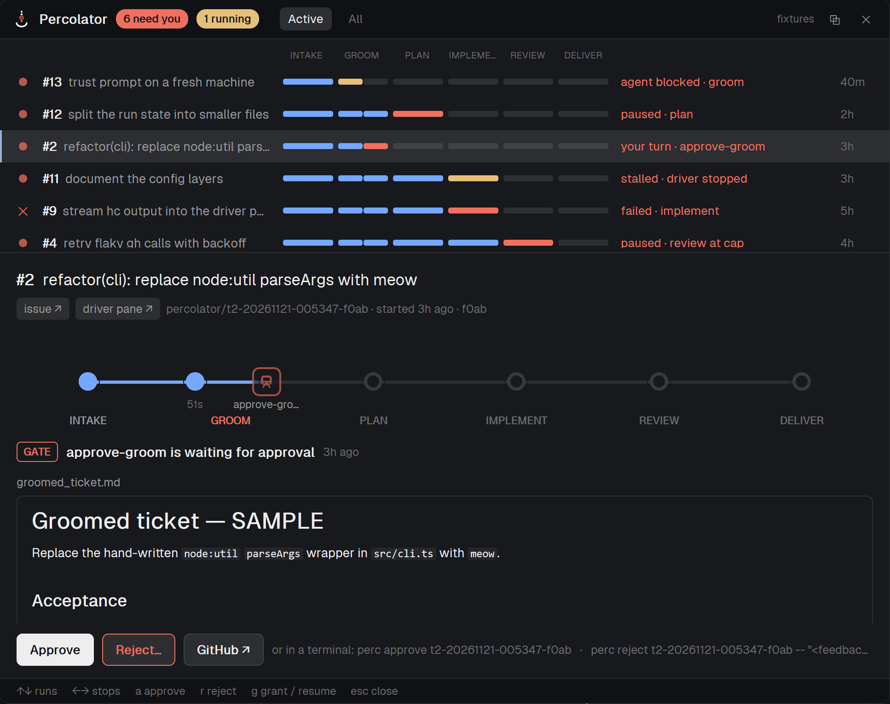

# Percolator

Herdr's own layout (a copy of its shipped `main`, 0.1.16) plus a Percolator panel and a status-bar cup. The cup, at the right end of the status bar, says how many Percolator runs need you ("2 need you", "1 running", or "Percolator") and shows or hides the panel. The panel lists every run as a row with its state line, and for the run you pick shows its pipeline top to bottom, the agent at work or what the run waits for, the file to review, and the buttons to answer (Approve, Reject, Resume, and so on). It reads `perc status --json` and answers by running `perc`.

The screenshot shows the panel popped out into its window, with sample data from `fixtures/status.json`.

## What you see

The layout is Herdr's `main` (sidebar with spaces and agents, tabs, work area, status bar) with two additions.

**The cup.** A 150px block at the right end of the 28px status row, next to the status text. It shows a 14px mark in the text colour (a cup under five drops, the middle drop a ring) and an 11.8px label: "N need(s) you", else "N running", else "Percolator". The ring is the "blocked" colour and pulses while something needs you, the "working" colour while something runs, muted otherwise. The label is "blocked" coloured when something needs you. While the panel or its window is open the button has the "raised" background. Tooltip: "Show Percolator" or "Hide Percolator"; the connection error when there is one; "Run perc herdr link once to connect" before linking.

**The panel.** A 380px block at the right of the work area (min 280, max 900), hidden until shown. Top to bottom:

1. Title bar: the mark (ring coloured needs-you, else working, else accent), "Percolator", the chips "N need you" and "N running" (the second only at 720 or wider), the tabs Active and All (the All tab adds "Delete finished runs ↗"; a notice, such as what fixtures mode would have run, shows beside them), then at the right **+ New run** (a `+` icon under 800, the words from 800; hidden until perc is linked or a fixture is set), the watcher, the word "Fixtures" (at 720 or wider, when the panel reads a sample file), a pop-out button (⧉) and a close button (✕), always at the right. The watcher is a dot ("working" coloured while `perc watch` runs, dim otherwise) and its label, "Watching N repos", "Starting…" (after Start watcher, until the first heartbeat, at most 60 s; no link meanwhile), "Watcher not responding" (a stale heartbeat while a live terminal is named `percolator-watch`; with **Stop**) or "Not watching", then a **Stop** link while it runs, or **Start watcher** when it does not and some earlier run used a repo (no link before the first run); under 720, or with the tabs on their own row, it is the dot alone, its tooltip giving the label and what a click does. When the panel is narrow, "Percolator" truncates first, then the chip shortens to "N" (under 400), then the tabs move to a second row (under 350, the chip long again from 270; with no chip, under 330).
2. Board: one row per run, needing-you first, then running, then newest. A row has a status icon (pulsing dot for something that needs you, ✕ failed, spinner running, ✓ done, ! unreadable), `#n` (none on a ticketless run), the title, a chip with the pipeline's name on any pipeline but `feature`, and the age; under them, for a linked run, its linked line; then the state line ("Your turn · approve-groom", "Your turn · pick-pipeline", "Paused · review at cap", "Paused · plan", "Failed · implement", "Stalled · driver stopped", "review · Round 2/3", "Delivered · PR #7"; a router's completed run "Routed → <pipeline>", a completed ticketless run with no PR and no opened issues "Done", whatever its exit; any other run its status, capitalised). The linked line: a run another started says `↳ from #42` (the parent's ticket, or the parent's pipeline when the ticket is the run's own or there is none, or the parent's id when the parent is not listed); a fan-out's slice says `↳ slice 2 of #42: <title>` (`↳ slice 2 of <pipeline>: <title>` when the parent has no ticket); a run that started others says `→ 3 runs`, and a fan-out parent `→ 4 slices · 2 started` while some slices have not started, then `→ 4 slices`. Clicking it selects that run (the parent, or the first listed run it started; on All when the Active tab hides it). The age counts from when the run started needing you, else from its start. Empty: the greyed mark and "No runs yet" (All) or "Nothing running, nothing waiting on you" (Active), then `perc run <ticket> [--pipeline <name>]`. The board scrolls when the runs don't fit; below it a 7px divider (a 1px border line, accent while dragged, row-resize cursor) sets its height.
3. Run header: `#n title` (the ticket ref until intake has read the issue) and the pipeline chip; links "Issue ↗" (once its URL is known), "PR ↗" (if any), "Driver pane ↗" (while the run's driver terminal is live), "▸ Run next…" (on a completed or failed run with a ticket or opened issues, while no run on its ticket is live), "Delete ↗"; then the branch (two columns only), started ago, short id.
4. Pipeline: the selected run top to bottom, one row per step in execution order: `before-all` hooks, then each stage with its `before:<stage>` hooks, its own steps and its `after:<stage>` hooks, then `after-all` hooks. Core steps sit on a 2px spine, accent down to the active row (or the last that ran), border after it. A core step is a 16px stop (filled accent once passed, filled "blocked" when it failed (a loop's start that sent the run back under its cap counts as passed: the loop goes on), outlined while it waits its turn; square-cornered at a gate) with its name in capitals and, once passed, its duration; the step a loop goes back to says "Round 3 · 4m" instead from round 2 on (the round, its latest attempt's time), and a hook it goes back to has "round 3" in its note. The active stop is a 24px ring with a dot, "working" coloured, or "blocked" when the run needs you or failed. Hooks hang on a 20px branch to the right of the spine: a 10px node (square-cornered at a gate), the id in monospace, and a muted note (where it runs: "Before", "After", `before-all` or `after-all`; the last gate decision such as "approved by @login", then its duration or "waiting 1d"). When one side of a stage (its `before` hooks, or its `after` hooks) has more than three passed hooks, or the panel is under 320px wide, that side's passed hooks fold into a "+n" beside their stage's name (tooltip "Also <ids>"; `before-all` hooks count as intake's, `after-all` as deliver's); the active hook, and one waiting, failed or not started, keeps its row. The 330px left column of two columns does not fold. A core step a loop starts from has a round pill at the right, "Round 2/3" ("· cap" added at the cap): a dim border and muted text before the loop is taken, "working" once taken, "blocked" at the cap. Each loop is a rounded bracket in the 26px gutter left of the spine, from its `from` row up to its `to` row, with an arrowhead into the `to` row, in the pill's colour; two loops sit 6px apart. A fan-out parent has one sub-row per slice under its fan-out stage (its last stage row), in either layout: an 8px dot in the slice's colour (accent completed, "blocked" failed, "working" running or waiting, dim otherwise), `<i>.`, the slice's title, the step its run is at ("Done", "Not started", the current step, or its status; in the dot's colour, muted where the dot is dim) and "PR ↗" once it has one. Clicking a row whose run is listed selects that run (on All when the Active tab hides it; tooltip: its id); a slice not started yet is not clickable.
5. Under the active stop (one column), or at the top of the right column (two columns):
   - An agent at work: the agent card, a badge with the program's initial, "<program> · <status>" (Herdr's status for the agent: "working" and "blocked" in their colours, anything else muted), the terminal name and how long the step has run, and "Open ↗" (one column) or "Open terminal ↗" (two columns). The card has a "working" border while its terminal is live; dim and inert while it is not. Before the step has a terminal: "Agent not started".
   - Needs you: a box with a "blocked" border: a tag (GATE, PAUSED, FAILED or STALLED), the message, the age (narrow: the tag and age on a line of their own, the message under them), an optional detail line (a failed fan-out slice: "Delete this slice (its branch stays), then resume <parent> to run it again"), the agent's program, status and terminal when the step has one, the first review file rendered as markdown, then the buttons. Action errors, and what fixtures mode would have run, show under the buttons.
   - Finished, and nothing under the stop: "DELIVERED · Opened <owner/repo/pull/n>" (or "Done."), a router's "ROUTED · → <pipeline>" (the row's "Routed → <pipeline>"), "DONE" for a run whose row says "Done", "UNREADABLE" and the error, or the run's status as a tag. In one column this shows under the pipeline, as does a box whose step has no row.
   - The picked stop's strip (under its row in one column; under the box in two): the step, then "Kind", "Stage", "Status", "Attempts" and "Took" with their values, its outputs as links, and the picked output (else the first) read under them.
   - History: a fold under a line, "History ▸ 3 attempts" ("▾" when open), closed by default, the choice kept while the panel lives. Open, the run history in a box that scrolls past 200px, newest first, one row per attempt: mark, step, round ("Round 2"), status, start time (HH:MM), time taken, and a note ("Approved by @login" for a gate decision). A loop that hit its cap adds a red ↺ row ("review → implement hit its cap of 3 rounds"). Against a perc that sends no timeline, one row per step that ran.
   A reader (the file to review, a stop's output) shows the file name and, in the docked panel, "Read full ↗"; it scrolls on its own past half the area under the title bar. A file the box already reads is not read again in the strip.
6. Key hint row (two columns only): "↑↓ runs · ←→ stops · ⏎ open agent · a approve · r reject · g grant / resume · esc close" ("esc parent" on a fan-out slice).

**The start picker.** **+ New run** (again closes it) and **▸ Run next…** open it in place of the board and the run, in a raised box that scrolls on its own; the title bar stays. Its title is "Start a run", or "Run next on #42" (the run's pipeline when it has no ticket). Top to bottom:

- **Repo:** the git repos of the spaces open in Herdr on this machine first (spaces on another machine are left out), in space order and tagged `Open` (a space in a run worktree, `<repo>/.worktrees/<run-id>`, lists `<repo>`), then the repos earlier runs used, most recent first, then **Choose folder…** (Herdr's folder picker, "Repo for this run"). Each repo is listed once, its paths compared case- and separator-insensitively on Windows. The shown space's repo is preselected, else the first open space's, else the latest run's. While a space's repo is still being looked up the preselection may move when it is found, until the owner picks, types or presses Start (never when `percolator.new/<pipeline>` opened it). In fixtures mode no open spaces are listed, so the picker shows only the fixture runs' repos. A typed ticket preselects the repo of the latest run on that GitHub repo. Run next shows the run's repo, fixed.
- **Pipeline:** one radio row per pipeline of the repo, as `perc pipelines --repo <repo> --json` lists them: the name, its tags ("Default", "No ticket", "Ticket optional") and, under it, its description (else "Ends with <exit>"). A pipeline that fails validation shows its error, greyed, and cannot be picked. The default is picked first (or the one a `percolator.new/<pipeline>` command names). Instead of the rows: "Choose a repo to list its pipelines" (under the Repo section above it), "Loading pipelines…", the error of the call (`perc pipelines --json failed for <repo>: <first stderr line>; check the repo's Percolator config`), or for Run next "No pipeline here takes a ticket". Run next lists only the pipelines that take a ticket.
- **Fields** of the picked pipeline: "Ticket" (marked "optional" on `ticket: optional`; none on `ticket: none`), a text field with the hint "URL or owner/repo#n" (Run next: the run's ticket, "From this run", or one row per ticket to choose among it and the issues its `issue` exit opened); then one field per input, labelled with its name ("optional" unless required), its description as the placeholder.
- **Foot:** the exact `perc run …` line it will run (monospace; an argument with spaces or `"` quoted), **Start** and **Cancel**, and a note: "Enter starts", or why Start is disabled ("Pick a pipeline", "Pick a repo", "Enter a ticket", "A ticket cannot start with -", "Enter <input>"), or the first stderr line when `perc run` failed. In fixtures mode Start only says `Fixture: would run perc run …`. Once started, the picker closes and the new run (from `run <id> started` on stdout) is selected. Esc cancels.
- **Preview** of the picked pipeline, as the pipeline above draws a run that has not started (stages, gates, hooks, loops, the exit), headed "Pipeline: <name>" and "N steps": below the picker under 720 wide, in a 300px column to its right from 720.

Widths here are design px: Herdr's zoom scales them, so at zoom 1.5 the 720 layout needs a 1080px panel. Under 720 the panel is one column: the board, the divider, then the header, pipeline and what is under it, scrolling together. From 720 it is two columns: on the left, 330px, the board, the divider and the pipeline, which scrolls; on the right, the header, the box (or how the run ended), the picked stop's strip and the History fold. The right column does not scroll as a whole, so the buttons stay in view; its readers take the height left.

**The window.** The panel can pop out into a floating 860x680 window (key `percolator`, remembers its place), the same view at the wider width: two columns.

Every colour comes from `theme()`; nothing is hard-coded, so it follows light and dark. Text you read is the foreground colour or, when secondary, muted; dim (too faint for text on the cards) is kept for disabled controls, a broken pipeline's name, decorative glyphs, dots and lines. Every label starts with a capital letter, and what follows a ` · ` stays lowercase; names (steps, pipelines, run ids, `perc …` lines, refs) keep their own case.

## How it behaves

**Statuses.** Each run is one of: needs you (a gate, a paused run, a failed run until `perc clean` removes its worktree, or a stalled run whose driver stopped), running, done. A run whose agent is blocked counts as running: Herdr already marks the agent, and the agent card under the active stop shows its "blocked" status. Needs-you is the red-orange "blocked" colour with a pulsing dot; running is the "working" colour with a spinner; done is a check.

**Clicks.** Cup: toggles the panel (or the window, whichever you last used). ✕ and Esc hide it. ⧉ pops the panel out into the window and hides the docked one; ⧉ in the window docks it back and closes the window. A row, or ↑/↓, selects a run. A pipeline row, or ←/→, picks its step and opens its strip; a click on the picked row, or Esc, closes it. A step that has not started can't be picked, by mouse or ←/→; it keeps its tooltip. ←/→ move up and down through every started step the pipeline shows, hooks included; folded hooks are skipped until their stage is unfolded (a picked hook that folds rings its stage, and its strip opens under it). Picking a stage with folded hooks unfolds them; closing it folds them again. The strip of a step that ran more than once has ‹ › to move between its rounds; the latest is shown first, marked "running", "waiting" or "latest"; each round's outputs open in its reader. The agent card, the active stop while an agent works there in a live terminal (tooltip "Open terminal"), Open terminal ↗ and Enter focus the agent's terminal (`agent.focus`); when it is not live they say "<terminal> is not a live terminal; refresh the panel", and in fixtures mode "Fixtures: would open <terminal>". Read full ↗ pops the panel out into the window. The links in the run header open the issue or the PR; **Driver pane ↗** peeks at the run's driver terminal (`terminal.peek`): closing the peek leaves the driver, and the run, going.

**Buttons** come from the `actions` of the run in the JSON: Approve, Reject…, Grant a round & resume, Resume, Clean up, and at a router's `pick-pipeline` gate one **Run `<name>`** per pipeline in the attention's `choices` (each runs `approve <id> --pipeline <name>`), plus GitHub ↗ for gates, Open terminal ↗ while the step's agent terminal is live, and Driver pane ↗ in a failed or stalled box while the driver is live (its last screen often says why). Each action runs `perc` with an argv array (`approve <id>`, `reject <id> -- <feedback>`, ...). While it runs the button shows a spinner and the others are disabled; on exit 0 the panel refreshes; on failure the first stderr line shows under the buttons. Reject… opens a feedback box under the buttons (Ctrl+Enter sends, Esc cancels); empty feedback is refused with "Say what to change". Clean up asks once through Herdr's `confirm`. Approve and Reject do not confirm.

Every run's header, in both tabs and unreadable runs included, has **Delete ↗**; the All tab has **Delete finished runs ↗**. Each asks once through Herdr's `confirm`: Delete ↗ names the run and its ticket, says uncommitted worktree changes are lost (for an unreadable run: its worktree too, if its record still names one), the branch `percolator/<id>` is kept, and that an active run is stopped first; Delete finished runs ↗ lists the completed and failed runs it removes, or says "No finished runs" beside the button (until a finished run is listed) and opens no confirm. A delete confirmed while another action runs is not run; the panel says "Another action is running; try Delete again". After a delete the selection moves to the next run, else the previous one, else the empty state.

**Board height.** Drag the divider between the board and the run below: the board keeps at least two rows (or all its rows if fewer) and at most 70% of the area below the title bar; double-click resets it to 30%. The height is kept as a ratio of that area in shared state (`percolator.boardRatio`, saved by Herdr), so the docked panel and the window show the same proportion and it survives a restart; before the first drag, the older per-copy `localStorage` value `board.ratio` is used if there is one. ↑/↓ scroll the board to the selected row.

**Keys** (panel focused, not typing): ↑/↓ runs, ←/→ stops, Enter opens the agent at work, `a` approve, `r` reject, `g` grant or resume, Esc closes the start picker, then the reject box, then the stop strip, then on a fan-out slice selects its parent, else hides the panel. Backspace selects a slice's parent.

**Watcher.** Stop runs `perc watch stop`; Start watcher runs `perc watch` with a `--repo <dir>` for every repo earlier runs used. While either runs the link shows "…"; a failure's first stderr line shows beside the tabs, and in fixtures mode it says `Fixtures: would run perc watch …` there instead.

**Data.** On start, on each change under `~/.percolator/runs` (about 300ms after a burst) and every 10s, the cup runs `perc status --json`, and so does the panel copy where the panel lives (docked or window) while it is shown; a copy that comes back into view refreshes at once. If a call fails, the last good board stays and a one-line error bar says what failed and what to do (`perc status --json failed: <first stderr line>; check perc is installed and run perc herdr link`). Until `perc herdr link` has run, the panel shows only "Run perc herdr link once to connect".

**Notices.** When a run newly needs you (compared with the previous refresh, never on the first load), the cup posts a warning toast "#<n> needs you" with the message; clicking it shows the panel where you last had it (docked or window) and selects that run. A blocked agent gets no toast from the cup: it does not count as needing you, and Herdr may post its own notification for its agents.

**Where it is.** The place (docked or window) is remembered in shared state `percolator.place`. Only the copy that matches it acts on `percolator.*` commands and keys, so a docked panel and a window never both answer.

## Built from

**Where the files come from.** The `herdr/` folder of the Percolator repository, https://github.com/Zidious/percolator (private for now: you need access until it is public), next to this recipe. Copy these files as they are; build from the recipe only if they do not load on your Herdr version:

- `layouts/percolator.json`: Herdr's shipped `main` 0.1.16 (`cloned_from` records it) with two additions.
  - In `work-body` (the row after `main` and the Files/Changes `panel` column), a block `percolator-panel`: `hidden: true`, `size: {px: 380}`, `min: 280`, `max: 900`, `content: {mod: "percolator"}`. It is its own block, not a child of `panel-body`: Herdr's tabs mod hides stack children that are not in the space's `workspace.panels`, which would close the Percolator panel on every space switch.
  - In `status-row` (a row, 28px), after `status` (weight 1), a block `percolator-cup`: `size: {px: 150}`, `content: {mod: "percolator-cup"}`.
- `mods/percolator/` (the panel; plain JS, no build): `mod.json`, `main.js` (the view and its layout), `board.js`, `pipeline.js` (the run header, the pipeline and the stop strip), `turn.js` (the agent card, the box, the History fold), `start.js` (the start picker and its preview), `ui.js`, `model.js` (pure logic, the only reader of the JSON contract), `model.d.ts` (its types), `source.js` (runs `perc status --json` and `perc pipelines --json`, watches `~/.percolator/runs`), `mark.js`, and the art `glyph-base.svg`, `glyph-live.svg`, `loop-arrow.svg`. `mod.json` is `{"place": "none", "title": "Percolator", "overlay": {"kind": "window", "width": 860, "height": 680, "key": "percolator"}}`.
- `mods/percolator-cup/` (the cup): `mod.json` (`{"place": "none", "title": "Percolator cup"}`), `main.js`, and copies of the panel's `model.js`, `mark.js` and `source.js`.
- `fixtures/status.json` and `fixtures/samples/` (`findings.md`, `groomed_ticket.md`, `implement-log.md`, the review files that `status.json` points to by relative path): a sample `perc status --json`, for trying the panel without Percolator (see Install, step 5). `fixtures/pipelines.json` is a sample `perc pipelines --json`, which the start picker reads beside the status fixture; `fixtures/empty.json` is a status with no runs, for the empty board.
- `preview.png` and this recipe are for the listing; do not copy them into Herdr.

`"place": "none"` means Herdr does not dock the mod anywhere by itself; it shows only where a layout block (`percolator-panel`, `percolator-cup`) or an overlay (the window) puts it.

**Install.** Check the Herdr version first: `herdr-app --version` (this layout was cloned from 0.1.16; on another version, check the mods and layout as below and build from this recipe if they fail). If `herdr-app` is not on PATH, run it from where Herdr installed it (on Windows `%LOCALAPPDATA%\Programs\herdr-app\herdr-app.exe`).

1. Herdr's app home is `~/.config/herdr-app` on every OS (on Windows, `C:\Users\<you>\.config\herdr-app`), or the folder in `HERDR_APP_HOME` if set (`perc herdr link` respects it too). Layouts live in `<home>/layouts/<name>.json`, mods in `<home>/mods/<name>/`.
2. Copy `layouts/percolator.json` to `<home>/layouts/` and the two mod folders to `<home>/mods/`. Never overwrite. The names are fixed in the code (mods `percolator` and `percolator-cup`, layout block `percolator-panel`, the `percolator.*` and `percolator-cup.*` commands and shared-state keys), so renaming is not supported: if `layouts/percolator.json` or either mod folder already exists, stop and tell the person. Herdr loads new files live.
3. Check each mod: `herdr-app check <home>/mods/percolator` and `herdr-app check <home>/mods/percolator-cup`. Each prints `check passed: <folder>` and exits 0; on failure it prints the error and exits nonzero. (The check may add `gpui-kit.d.ts` and `jsconfig.json` to the mod folder; they are Herdr's and harmless.)
4. Switch to the layout: `herdr-app do layout.switch --name percolator` (or `ctrl-shift-l` until it shows; the same key cycles back to the person's layout). It returns with no error and the window redraws. Confirm with `herdr-app status`: its JSON has `"layout": "percolator"` and `"errors": []`.
5. Connect to perc. Both mods read only `<home>/mods/percolator/perc.json` (the cup carries the panel's `source.js`, which always looks in that folder). Either:
   - (a) Fixtures, written by hand: `{"fixtures": "<path to herdr/fixtures/status.json>"}`, for example `{"fixtures": "C:/Users/you/percolator/herdr/fixtures/status.json"}` (forward slashes, or doubled backslashes, in JSON). Keep `fixtures/samples/` and `pipelines.json` beside `status.json`: the review and output paths inside it are relative to that file's folder, and the start picker reads `pipelines.json` from that folder (without it, it says `<folder>/pipelines.json not found; put pipelines.json beside the status fixture`). A relative `fixtures` path works too, resolved against `<home>/mods/percolator/`; use an absolute one.
   - (b) Real runs. You need Node 24 or later (it runs the `.ts` sources directly), pnpm 12 or later (https://pnpm.io/installation) and a checkout of the Percolator repository: `git clone https://github.com/Zidious/percolator`, then in it `pnpm install --frozen-lockfile`. After step 2, run `node src/cli.ts herdr link` in the checkout (`perc herdr link` only if `perc` is installed on PATH). It writes `perc.json` as `{"node": "<absolute path of node>", "cli": "<absolute path of perc's cli>"}`. It fails with `perc herdr link: no Herdr config at <home>; install Herdr first` if the home does not exist, and with `perc herdr link: <home>/mods/percolator not found; add the Percolator layout to Herdr first (see herdr/RECIPE.md)` if the panel mod is not copied yet. Linking replaces fixtures mode; moving or reinstalling the checkout means linking again.
6. Reload the mods, because `perc.json` is read when they start: save a file in `<home>/mods/percolator/` and in `<home>/mods/percolator-cup/` (Herdr reloads every copy of a mod when any file in its folder is saved; rewrite `main.js` with its own content), or restart Herdr. Confirm the reload: `herdr-app status` shows `"errors": []`, and the cup's tooltip no longer says "Run perc herdr link once to connect".

Shipped mods used: `workspace-chrome`, `spaces`, `agents`, `tabs`, `files`, `changes`, `pane`, `workspace-status` (all from `main`).

`herdr` functions used: `exec` (runs `perc`), `readTextFile`, `watchFolder`, `appHome`, `home`, `layout`, `run` (`layout.show`, `layout.hide`, `agent.focus` for the agent's terminal, `terminal.peek` for the driver), `terminals` (whether a terminal is live; perc gives hc terminal names, matched against `terminals()` names or addresses, and `agent.focus` and `terminal.peek` get the address), `agents` (the agent card's program and status), `settings` (the zoom, to measure in design px), `openOverlay` and `closeOverlay`, `props`, `spaces` (the open spaces' folders, for the start picker's repos), `shared` and `setShared`, `nextCommand`, `notify`, `checking`, `theme`, `pickFolder` (the start picker's Choose folder…); Clean up, Delete ↗ and Delete finished runs ↗ open Herdr's shipped `confirm` mod as an overlay. Shared state keys: `percolator.place` (`"panel"` or `"window"`), `percolator.window` (the open window's overlay id), `percolator.focus` (`{run, at}`: the run to select). Commands: `percolator.*` (`key/<key>`, `clean/<id>`, `delete/<id>[,<id>…]` (the runs a delete confirm listed), `new` and `new/<pipeline>` (open the start picker, with that pipeline picked), `next` (Run next… on the selected run), `start` (the picker's Start), `place`, `focus`) and `percolator-cup.*` (`open/<run-id>`, `toggle`). The window opens with `openOverlay({kind: "window", key: "percolator", keep: true, mod: "percolator", width: 860, height: 680})`.

Programs it runs: `node <cli> status --json`; `node <cli> pipelines --repo <dir> --json` when the start picker opens or its repo changes; `node <cli> run [<ticket>] --repo <dir> --pipeline <name> [--input <name>=<value>]…` for Start; `git rev-parse --show-toplevel` in each local space folder (once per folder, argv only, 10s timeout) for the start picker's repos; `node <cli> watch --repo <dir>…` and `node <cli> watch stop` for the watcher; and, for the buttons, `node <cli> approve|reject|resume|clean|...` (a Run `<name>` button runs `approve <id> --pipeline <name>`; Delete ↗ runs `delete <id> --yes`, Delete finished runs ↗ `delete <id> <id>… --yes` with the ids its confirm listed, so a run that finishes while the dialog is open is kept), where `node` and `<cli>` come from `mods/percolator/perc.json`: `{"node": "<absolute path of node>", "cli": "<absolute path of perc's cli>"}`. `perc herdr link` writes this file. It runs `node` directly, with no shell, so it works on Windows (no `.cmd` shim) and does not depend on PATH.

The data contracts are the output of `perc status --json` (schema field `schema`, 2) and `perc pipelines --json` (`schema` 1); `model.js` is their only reader.

## Watch out

- **This is a copy of Herdr's `main` 0.1.16.** It does not follow later changes to `main`. To pick those up, re-add the listing afresh, or copy the two additions (the `percolator-panel` and `percolator-cup` blocks) into your own layout.
- **The mod runs programs and reads your files.** It runs `node` with perc's CLI and reads `~/.percolator/runs`, the review files and outputs perc points to, and `mods/percolator/perc.json`. It makes no network calls. Tell the person before adding it.
- **`perc herdr link` is required for real runs** (Install, step 5). Until `perc.json` exists the panel and cup show "Run perc herdr link once to connect" (the panel shows nothing else; the cup's label stays "Percolator"); an unreadable `perc.json` counts as missing.
- **Herdr refuses imports across mod folders.** That is why `mods/percolator-cup/` has its own copies of the panel's `model.js`, `mark.js` and `source.js`. They must stay byte-identical: edit the panel's file, then copy it over the cup's. In a repo checkout only: `node --test tests/herdr/cup.test.ts` checks they are equal.
- **Mods-only install** (no layout copy, so no cup, no docked panel and no notices): copy `mods/percolator/` only, then connect as in Install, step 5. Open the window with the command `mod.open` and the name `percolator`. To bind a key, add this to `<home>/keys.json` (merge into the person's file; ask before replacing a key they use): `{"global": {"ctrl-alt-p": "mod.open:percolator"}}`. With the cup installed, `"ctrl-alt-p": "percolator-cup.toggle"` toggles the panel instead.
- **Updating the mods.** A newer version can drop files an older one had (for example `train.js` and `train.svg`), and a stale file can import exports that are gone. Replace each mod folder's files with the new ones and delete any file the new version does not have, keeping `perc.json`. In a repo checkout, `pnpm herdr:sync` does this (it mirrors `herdr/mods/*` into `<home>/mods/`, respecting `HERDR_APP_HOME`, and lists what it removed).
- **The window uses key `percolator` with `keep: true`**, so it remembers its place; the docked block is `percolator-panel`.
- **One copy acts.** The docked panel and the window can both exist; only the one matching `percolator.place` handles `percolator.*` commands and keys.
- **A blocked agent is Herdr's.** The panel counts its run as running and the cup posts no toast for it; Herdr's own agent status (and any notification it posts) tells you, and the agent card shows its status.

## Done when

Items marked (eyes) need the person to look at the window; the rest an agent can check.

- `herdr-app check` on `mods/percolator/` and on `mods/percolator-cup/` prints `check passed`.
- After the switch (Install, step 4), `herdr-app status` shows `"layout": "percolator"`; (eyes) Herdr's normal layout appears with the cup at the right end of the status bar, labelled "Percolator" (its tooltip, before any `perc.json` exists, reads "Run perc herdr link once to connect").
- With `perc.json` set to the fixture and the mods reloaded: (eyes) the cup reads "N need you" with a pulsing ring; a click shows the 380px panel with the board, one column.
- (eyes) The panel stays open after you switch to another space.
- (eyes) Selecting the gate run shows a GATE tag, the groomed ticket rendered as markdown, and Approve, Reject… and GitHub ↗ buttons; Approve says what it would run (fixtures mode).
- (eyes) Selecting a run shows its pipeline: stops on the spine, hooks on branches to its right, each loop as a bracket with an arrowhead into the row it returns to, a round pill on the step it starts from. A running run shows the agent card under its active stop (dim in fixtures mode: no terminal is live).
- (eyes) ⧉ closes the docked panel and opens the 860x680 window in two columns, the board and pipeline left, the run right, and "Fixtures" in the title bar; ⧉ in the window closes it and docks the panel again.
- (eyes) Cup click, ✕ and Esc each hide a shown panel; a click on a "needs you" toast shows the panel on that run.
- (eyes) In fixtures mode the title bar shows the watcher as "Watching 1 repo" with Stop (in the window; a dot in the docked panel); clicking Stop says `Fixtures: would run perc watch stop` beside the tabs.
- (eyes) **+ New run** opens the start picker over the board, with the Repo section first (no `Open` repos in fixtures mode), listing the pipelines of `fixtures/pipelines.json` with the default picked and its preview below (to the right in the window); Start stays disabled with a reason until the pipeline's fields and a repo are filled, then says `Fixture: would run perc run …`; Esc closes it. A finished fixture run with a ticket shows **▸ Run next…** in its header, which opens the same picker with its ticket and repo fixed.
- (eyes) The fixture's fan-out parent (#23, `epic`) shows three slice rows under its fan-out stage and `→ 3 slices · 2 started` under its title; a started slice's row selects that slice, whose line reads `↳ slice 1 of #23: <title>`.
- After `perc herdr link` and a mod reload: (eyes) the panel and cup show your real runs, the same as `perc status --json`, and the "Run perc herdr link once to connect" tooltip is gone.
- (eyes) A light and a dark appearance both read well.
